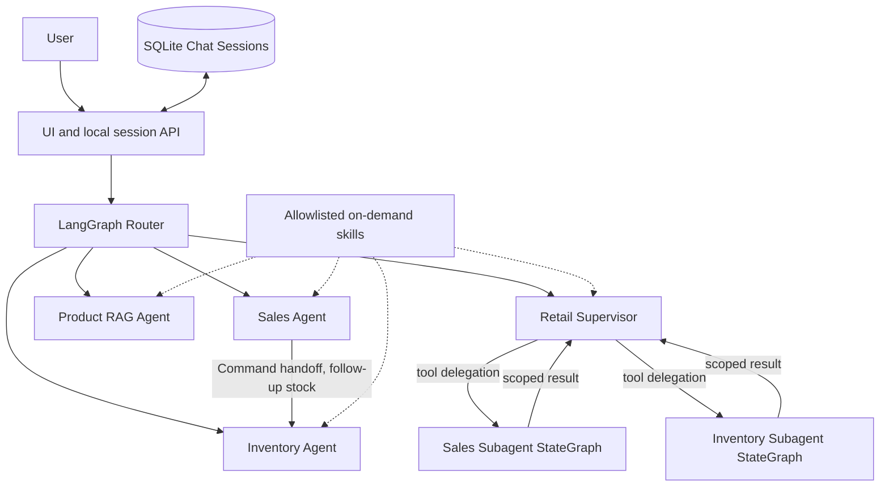

# Week 1 FDE Extension: Router, Subagent, Handoff, Skill, Session Memory

## Business case and FDE approach
**Product-level hypothesis:** Retail staff may need to navigate multiple existing operational tools and reports to retrieve, reconcile and interpret information. **RetailIQ aims for Faster · Easier · Reliable task completion through natural-language conversation.** The bestseller/stock replenishment review below is **one multi-source demo scenario**, not the overarching problem. This is synthetic and *not validated via retailer interviews or measured UX/time benefit*.

- **AS-IS (hypothesized):** human-operated navigation, filtering and reconciliation across existing POS/BI/ERP/WMS/catalog tools; “manual” does **not** mean no software.
- **TO-BE:** a multi-agent conversational assistant routes read-only domain queries, performs evidence-backed cross-source review and preserves selected conversation context. Faster/Easier are **targets**, not certified outcomes.
- **Non-goals:** creating purchase orders, changing prices, authenticating users, accessing real ERP, or predicting future demand.
- **Engineering/demo checks:** four required baseline questions; cross-domain review; Sales→Inventory handoff; skill/subagent/router/custom workflow evidence; follow-up product resolution; session isolation; delete history. **Business acceptance (separate):** task time, interaction effort, post-task ease and independently checked task success; not yet measured.

## Roles and four agent patterns

**Router:** LLM structured intent classification with deterministic fallback; a typed LangGraph `Command` selects a specialist. `route_fallback` makes fallback visible.

**Subagent:** Supervisor calls two *isolated* LangGraph subgraphs through LangChain `@tool` wrappers. They return sales and inventory evidence to the supervisor. Subagents cannot mutate inventory.

**Handoff:** Following a Sales Agent turn, a stock follow-up starts at Sales Agent and executes `Command(goto='inventory_agent', update={...})`. This is control transfer, not a mere label. `handoff` is returned to UI.

**Skill:** Four allowlisted Markdown business instructions are loaded on demand by agent type from `retailiq/skills/`. Product Agent incorporates grounded-answer skill text into its model prompt. For read-only SQL roles, vetted function and documented rules bind tool access; do not treat RAG documents as executable skills.

## Session management

Local chat history stored separately from inventory database in `data/chat_sessions.sqlite3` (ignored by Git). `sessions` row stores UUID, title, active agent, timestamps; `messages` table stores typed user/assistant turns. History is bounded to last 12 messages for agent context. A request without `session_id` is stateless and backwards-compatible.

| Method | API | Purpose |
|---|---|---|
| POST | `/api/sessions` | New UUID session |
| GET | `/api/sessions` | List 50 most recent conversations |
| GET | `/api/sessions/{uuid}` | Read messages |
| DELETE | `/api/sessions/{uuid}` | Remove session and messages |
| POST | `/ask` | Accept `question` and optional `session_id` |

Browser stores **only active session UUID** locally; server stores messages. No cookies or credential values in UI. **Security caveat:** local demonstration is unauthenticated, so do not expose this service to network or production.

## Sample guided demo

1. **New chat** → “Which products are top sellers?” → Sales Agent.
2. **Same chat** → “How many units of the top seller are in stock?” → Sales→Inventory Handoff; uses SKU from ranked data.
3. **New chat** → “Tell me about USB-C GaN Charger 65W” → Product Agent and product grounding skill; live mode requires Chroma embeddings.
4. **Same chat** → “What about its stock?” → context-resolved SKU, Inventory Agent.
5. **New chat** → “Which top seller needs a replenishment review based on stock?” → Supervisor, two subagents, heuristic rule.
6. Switch sessions and reload page; show separate histories. Delete the test chat.

## Validation and limitations

- Flexible references such as “the first one” or “what about Hanoi?” are **target follow-up cases**, not proven in this demo; existing routing resolves only selected references and may need clarification. Do not script an unsupported phrase as a verified pass.
- `pytest` offline regression validates APIs, SQL, graph-independent routing, session persistence and skill policy.
- `tests/test_langgraph_smoke.py` requires real installed LangGraph; CI installs it and tests compiled graph with a stub model and deterministic SQL tools.
- **Not yet verified with external LLM, Chroma embedding, RAGAS judge or LangSmith trace**. Do not present these as completed E2E until tested with valid credentials.
- No multi-tenant authorization, history summarization, purchase order approvals or production load testing. SKU resolution uses simple name matching and should be tightened in later iterations.
