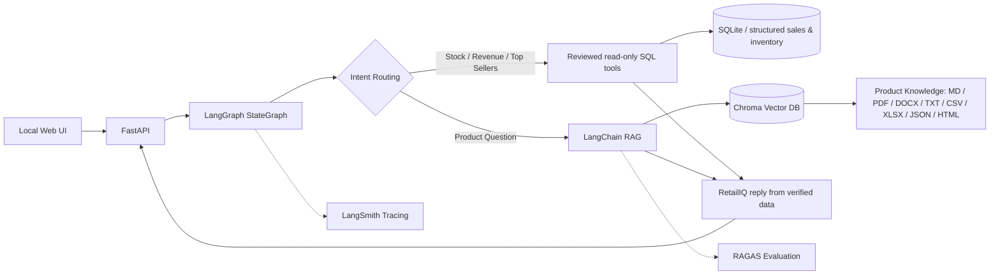

# Architecture & Tech Stack

**Business goal:** Reduce user interaction complexity and, where supported by measurement, end-to-end task completion time for retail information access, **without sacrificing correctness** (Faster · Easier · Reliable). Inventory/Sales data is the initial domain; Replenishment Review is a multi-source demo case, not the only outcome. This is a **proposed value hypothesis**, not proven ROI.

**Data-source mapping:** In a real retailer, POS/OMS holds sales transactions, ERP/WMS holds stock/reservations, and PIM/product documents hold identity/specifications. The current local application models these using synthetic SQLite tables and local product files. No live POS/WMS integration or inventory freshness SLA exists.

**Tool/agent selection rule:** for a simple question route to one trusted domain function; for cross-source questions, orchestrate reviewed sales/inventory tools, preserve SKU identity and verify evidence. A deterministic tool executor is not automatically an autonomous agent; no unchecked LLM-generated SQL.

**Scope of the diagram:** This shows the chat/assistant path only. The workspace also exposes a **separate** deterministic workflow API at `retailiq/api/workflows.py`; events from `retailiq/domain/workflow_demo.py` drive a graph *view* and should not be conflated with executed LangGraph agent invocations. See [Basic & Detail Design](DESIGN.md) for both paths.

## Justifications
- **Python 3.12**: compact implementation for team/course.
- **LangGraph**: typed state, conditional route, explicit nodes. LangChain `@tool` wraps vetted parameterized SQL.
- **LangChain ChatOpenAI/OpenAIEmbeddings + Chroma**: one OpenAI-compatible base URL and key, with separate chat and embedding model identifiers; full-mode product vector RAG.
- **SQLite**: reproducible stock/order sales; read-only query connection, aggregate in SQL.
- **FastAPI + legacy HTML/JS plus React 19/TypeScript/Vite**: the original UI remains at `/`; the merged Product Workspace at `/workspace` visualizes event-grounded execution graphs. Its graph renderer is a view of recorded events, not an orchestration engine.
- **LangSmith**: enable traces via API key in full mode; telemetry is hosted even though application runs local.
- **RAGAS**: faithfulness and answer relevancy on product RAG with LLM judge in separate evaluation script.
- **pytest**: deterministic SQL and business calculation tests distinct from RAGAS.

## Contracts
`stock`: on_hand, reserved, available=on_hand-reserved, updated_at per location. `revenue`: completed orders only, line-level discount applied, before returns. `top`: monthly units sold. `product`: source-addressable multi-format knowledge documents; never use those docs for real-time stock.

## Logical tools and execution responsibilities

The names below describe **proposed domain contracts**, not newly implemented public API names. Existing code paths remain the source of truth. Do not rename working tools just to match a diagram.

| Logical tool capability | Existing local implementation | Responsible execution path | Guardrail |
|---|---|---|---|
| Resolve product identity | queries.product_sku + domain.analytics.products | Inventory / Product lookup helpers | Unique exact SKU/name; ambiguity asks for clarification |
| Sales summary/revenue | domain.analytics.revenue | Sales Agent | Completed orders in configured month; VND net definition |
| Top sellers | domain.analytics.top | Sales Agent | Completed-order units; stable SKU tie-break |
| Inventory by SKU | domain.analytics.inventory | Inventory Agent | Read-only, available = on_hand − reserved, location and timestamp |
| Product knowledge retrieval | retrieval.retrieve and rag modules | Product Agent | Cite source; documents **not** inventory truth |
| Replenishment review | orchestration.agents.review_from_evidence | Supervisor with Sales/Inventory subagents | Match **same SKU** and verify numbers; human review only |

**Orchestration responsibility:** Router selects a specialist for single-domain questions. Supervisor coordinates dependent Sales → verified SKU → Inventory tool calls for the featured review, and a deterministic verifier checks the calculation. **Handoff** is a separate conversation-driven transfer. Source tools and the business verifier are **not individual autonomous agents** merely because they appear as graph nodes. Real tool execution/trace evidence is required to claim a live pattern demo.

## Pattern execution and business UX acceptance

- **Chain:** product retrieval → evidence construction → model answer → citation verification; no separate LCEL RunnableSequence claimed.
- **Router + Agent:** classify natural-language intent and dispatch a Sales/Inventory/Product specialist (full-mode execution must be verified separately).
- **Subagent + Custom Workflow + Skill:** Supervisor coordinates Sales and Inventory subagents for a reviewed top-seller replenishment case, using approved business definitions.
- **Handoff:** Sales → Inventory follow-up; flexible referents like “the first one” / “what about Hanoi?” are **not yet fully implemented or accepted**.
- **Business measurement:** compare **end-to-end task time**, **interaction steps**, **post-task ease rating** and **answer correctness** against equivalent human-operated tools. Current synthetic pilot lacks a structured ease-of-use measurement, and there is no real retailer baseline.

## Implementation maturity (reviewed 2026-10-31)

- **Data reliability:** Local implementations include freshness policy, semantic KPI layer, real local MCP stdio Inventory/Order, scoped consented memory and hybrid product retrieval. Live freshness, cross-session authenticated identity and provider retrieval-quality acceptance are still open.
- **Governance:** Approval, location scope and KPI alerts are primarily deterministic simulations; role selection is not authentication, and Langfuse/DeepEval live gates remain open.
- **Multi-agent workflow simulations:** Five named specialist roles, stock allocation, verification and manager gate are exercised in a local workflow; this does **not** establish five autonomous agents, interoperable A2A, secure approvals or real order mutations.

The [Capability Acceptance Ledger](29_COURSE_CAPABILITY_ACCEPTANCE_LEDGER.md) is the current requirement-level status source. [RetailIQ High-Level Overview](RETAILIQ_HIGH_LEVEL_OVERVIEW.md) is a dated historical assessment, not a second canonical architecture or status source.

## Limitations
The 2026-10-29 local full-mode run has scripted LangGraph/Chroma evidence, a three-question RAGAS report, and inspected remote LangSmith traces (see `docs/weeks/week-01/EVIDENCE.md`). Re-run on the demo machine; this does not establish open-ended question reliability or production readiness. No unverified capability is claimed as PASS. No production-grade authentication or authorized order/pricing mutation is established.

## Current code and quality boundaries

| Responsibility | Source / constraint |
|---|---|
| Public chat/API | `retailiq/assistant.py`, `retailiq/api/`; localhost application |
| Agent orchestration | `retailiq/orchestration/week1_graph.py`; router, explicit transfer, scoped supervisor |
| KPI/SQL truth | `retailiq/domain/analytics.py`, `retailiq/queries.py`; vetted read-only queries, no arbitrary generated SQL |
| Product document retrieval | `retailiq/rag/`, `retailiq/retrieval.py`; citation-grounded facts, not stock truth |
| User-facing reply | `retailiq/reply.py`, `web/index.html`; display and graph activity separate from source verification |
| Observability | `retailiq/observability.py` local JSONL/SSE; remote LangSmith is a different evidence source |
| Engineering quality | Source checks, unit/API, mocked compiled-graph, provider-backed tests; fail closed on invalid evidence |

**Permanent quality rules:** reviewed business invariants, parameter validation, idempotent read-only tools, safe missing-data behavior, bounded context/retries, secret-safe logs, explicit test modes and source provenance. Preserve details of earlier patch work in [archive](archive/README.md), not in new top-level technical notes. Implementation-aligned Basic/Detail Design is in [Design](DESIGN.md). Historical pattern teaching is in [Week 1 DESIGN](weeks/week-01/DESIGN.md), while dated verification is in [EVIDENCE](weeks/week-01/EVIDENCE.md).
