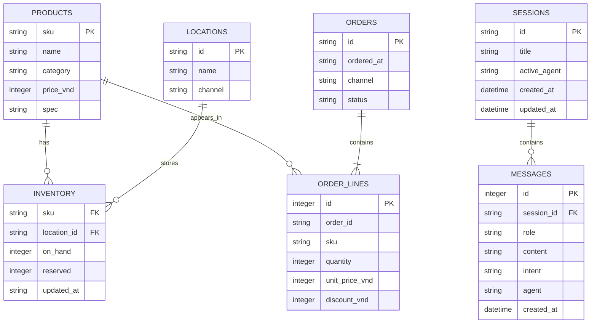

# RetailIQ Copilot — Data and API Contract

> **Version:** 0.1 · **Status:** Draft for engineering/BA review · **Last updated:** 2026-10-28
> **Accountable roles:** Tech Lead / Backend (API/schema), BA / Domain Analyst (business definitions).
> Current Week 1 local-demo contract; not a production integration contract.

## Data sources and freshness

**Why these sources:** A natural-language retail information question may ordinarily require a human to switch between POS/OMS (sales), ERP/WMS (available stock) and PIM/product documents (product facts). The Week 1 demo **simulates** these sources in one SQLite fixture and local documents. It does **not** integrate live POS/WMS APIs; combining tables in one database is a useful engineering simplification, not empirical evidence of the actual manual workflow. Source/system distinctions are **logical contracts**:

| Real-world conceptual owner | Demo backing data | Business authority |
|---|---|---|
| POS / OMS | orders, order_lines | Completed sales quantities, net revenue by period and top sellers |
| ERP / WMS | inventory, locations | On-hand, reserved, available and stock update timestamps |
| Product Master / PIM | products | Stable SKU and product identity |
| Product documents | Local knowledge files | Product specifications only; never authoritative for inventory availability |

| Data | Source of truth in this demo | Freshness / limitations |
|---|---|---|
| Product catalog, inventory, sales facts | Synthetic SQLite file `data/retailiq.sqlite3`, generated by `python -m scripts.seed` | Seeded data only; no upstream retailer system or live refresh. Re-seeding replaces this database. |
| Product knowledge | Local supported files under `data/product_docs/` and `data/knowledge/` | Chroma index is local and namespaced by embedding endpoint/model; build/update it explicitly with `python -m scripts.index_products`. Offline uses lexical retrieval, not vector search. |
| Chat sessions | Local SQLite `data/chat_sessions.sqlite3` (override with `RETAILIQ_CHAT_DB`) | Durable local demo history; no authentication, tenant separation, or encryption guarantee. |
| Local events | Rotating JSONL `data/logs/retailiq.jsonl` (override with `RETAILIQ_LOG_FILE`) | Bounded diagnostics, not immutable audit data or LangSmith traces. |

`RETAILIQ_AS_OF` selects the synthetic reference date and the default reporting month. Sales questions can request another month (for example, “doanh thu tháng 9”); without a year, that month uses the reference year. API `as_of` reports the selected `YYYY-MM` period. Inventory rows have their own `updated_at`; full-mode analytics validate timestamp/timezone and stock invariants. No maximum-age freshness guarantee is defined.

## Conceptual ERD



The ERD shows logical relationships. The seed schema enforces the inventory primary key and `on_hand >= reserved >= 0` check, but does not declare all foreign keys shown above. Chat sessions/messages are stored separately from the retail analytics fixture.

## Data dictionary

### Retail analytics tables

| Table / field | Type | Meaning and contract |
|---|---|---|
| `products.sku` | text, primary key | Stable product identifier, such as `EL-001` |
| `products.name` | text | Display name; used for exact product matching |
| `products.category` | text | Synthetic catalog category |
| `products.price_vnd` | integer | Synthetic list price; not used as realized revenue |
| `products.spec` | text | Synthetic product specification |
| `products.catalog_added_at` | ISO date text | Date the product was added to the synthetic demo catalog; used for “newest products”, not a market launch date |
| `locations.id` | text, primary key | Location code |
| `locations.name` | text | Display location |
| `locations.channel` | text | Synthetic location type, such as `warehouse` or `store` |
| `inventory.sku` | text | Product identifier |
| `inventory.location_id` | text | Location identifier |
| `inventory.on_hand` | integer | Physical units recorded at the location |
| `inventory.reserved` | integer | Units reserved at the location |
| `inventory.updated_at` | text | Seed timestamp for that location row, with offset in seeded records |
| `orders.id` | text, primary key | Synthetic order identifier |
| `orders.ordered_at` | text/date | Order date used to select the reporting month |
| `orders.channel` | text | Synthetic channel, currently `online` or `store` |
| `orders.status` | text | Synthetic order state; only `completed` contributes to revenue/top sellers |
| `order_lines.id` | integer, primary key | Synthetic order-line identifier |
| `order_lines.order_id` | text | Parent order identifier |
| `order_lines.sku` | text | Product identifier |
| `order_lines.quantity` | integer | Units on the line |
| `order_lines.unit_price_vnd` | integer | Per-unit line price in VND |
| `order_lines.discount_vnd` | integer | Discount for the entire line in VND, not a per-unit discount |

### Chat tables

| Table / field | Type | Meaning and contract |
|---|---|---|
| `sessions.id` | UUID text, primary key | Locally generated conversation ID |
| `sessions.title` | text, max 80 chars at creation | User title or first-question preview |
| `sessions.active_agent` | text | Last successful active-agent label |
| `sessions.created_at`, `updated_at` | timestamp text | SQLite timestamps |
| `messages.id` | integer, primary key | Local message row ID |
| `messages.session_id` | UUID text | Parent session; deleted with session via cascade |
| `messages.role` | enum text | `user` or `assistant` |
| `messages.content` | text | Question or answer stored locally |
| `messages.intent`, `agent` | nullable text | Execution metadata, populated for assistant turn |
| `messages.evidence_json` | nullable JSON text | Bounded, persisted evidence metadata for assistant messages (records, source identifiers, intent, period); not a replacement for authoritative business data |
| `messages.created_at` | timestamp text | SQLite timestamp |

## KPI definitions

| KPI | Canonical Week 1 definition | Exclusions / caveats |
|---|---|---|
| Available stock | Per location: `on_hand - reserved`; product total: sum of per-location available units | Not a forecast, purchase recommendation, or freshness guarantee. Product docs are not the stock source. |
| Monthly revenue | Completed orders whose `ordered_at` month matches `RETAILIQ_AS_OF`: `SUM(quantity * unit_price_vnd - discount_vnd)`, grouped by channel | Before returns/refunds, tax, and shipping. Discount is line-level. |
| Top sellers | Sum `quantity` for completed-order lines in the selected month, grouped by product; top five by units descending then SKU ascending | Units sold, not gross-margin or revenue ranking. |
| Product details | Retrieved local product-document content with source path | Does not establish current inventory, price availability, or a real warranty/policy. |

## HTTP API

FastAPI publishes the machine-readable schema at `GET /openapi.json` while the app is running. No API versioning or authentication is implemented.

### Health and chat

#### `GET /health`

Response `200`: `{"status":"ok"}`. This is process health only; it does not validate provider credentials or live integrations. The app's local-only middleware rejects requests with a non-loopback peer/Host using `403`.

#### `POST /ask`

Request:

```json
{"question":"How many units of AlphaBook Pro 14 are currently in stock?","session_id":null}
```

`question` is required and 3–500 characters. `session_id` is optional/null; when supplied it must be 36 characters and refer to an existing session.

Response `200` includes `question`, `intent`, `mode`, `as_of` (`YYYY-MM`), `active_agent`, `handoff`, `subagents`, `skill`, `answer`, `records`, `contexts`, `session_id`, and `request_id`. Full graph execution also returns `route_fallback`. Values may be empty/null when not relevant. `X-Request-ID` matches `request_id`.

Illustrative offline stock response shape (sample values from the seeded fixture):

```json
{
  "question":"How many units of AlphaBook Pro 14 are currently in stock?",
  "intent":"stock",
  "mode":"OFFLINE deterministic fallback — not LangGraph/VectorDB",
  "as_of":"2026-10",
  "active_agent":"inventory_agent",
  "handoff":null,
  "subagents":[],
  "skill":"inventory_availability",
  "answer":"AlphaBook Pro 14 (EL-001): 108 available units across locations.",
  "records":[{"sku":"EL-001","name":"AlphaBook Pro 14","location_id":"WH-HCM","location":"HCMC Warehouse","channel":"warehouse","on_hand":25,"reserved":0,"available":25,"updated_at":"2026-10-28 09:00 +07:00"}],
  "contexts":[],
  "session_id":null,
  "request_id":"<generated-request-id>"
}
```

The real `records` array contains one row per location. Product retrieval responses place source/text/metadata in `contexts`. Typical errors: `404` unknown session; `409` session already processing a turn; `422` request validation; `503` unavailable product index (run `python -m scripts.index_products`) or other execution failure. FastAPI uses the `{"detail": ...}` error envelope. Requests outside the local-only peer/Host boundary receive `403`.

#### `POST /ask/stream`

Uses the same request validation and returns Server-Sent Events over HTTP POST. Event sequence: `started`, zero or more `log`, then `result`, then `done`; on execution failure it emits `error`, then `done`. Events are allowlisted metadata, not token-by-token output. Missing session returns `404` before streaming. A busy session emits `session_busy`; an unavailable product index emits `index_not_ready`. At most eight streaming workers are admitted; excess requests receive `503` with `Retry-After`. Content type is `text/event-stream`.

### Sessions

| Method and path | Success | Behavior |
|---|---|---|
| `POST /api/sessions` | `201` | Optional `{"title":"..."}` (max 80 chars); creates and returns a session |
| `GET /api/sessions` | `200` | Returns `{"sessions":[...]}`, newest updated first; default list limit is 50 |
| `GET /api/sessions/{session_id}` | `200` | Returns session and up to 200 newest messages in ascending display order, plus `messages_truncated`; `404` if missing |
| `DELETE /api/sessions/{session_id}` | `204` | Deletes graph checkpoints and then session/messages; `404` if missing, `409` while a turn is active, `503` if checkpoint cleanup fails |

Invalid body values return `422`. These endpoints are not authenticated or user-scoped.

### Cost/ROI calculator

| Method and path | Request / response |
|---|---|
| `GET /api/roi/defaults` | Returns default values for the estimate form |
| `POST /api/roi/estimate` | Accepts workload, time/cost assumptions, token counts, and editable USD rates. Returns `report_type: illustrative_estimate`, `business`, `agent_cost_estimate`, `sensitivity`, and assumptions. Invalid/out-of-range values return `422`. |

Exact per-field bounds are defined by `ROIForm` in `retailiq/api/roi.py`. USD token cost is informational and must not be deducted again from the all-in VND budget.

### Local logs

`GET /api/logs?limit=80&session_id=<36-char-id>&request_id=<id>&level=ERROR` returns `events`, `source: local_rotating_jsonl`, `logging_health`, and a safe note. `limit` is 1–200; level is INFO/WARNING/ERROR/DEBUG. The route is loopback-only (`403` otherwise), uses `Cache-Control: no-store`, and invalid filters return `422`. Middleware also rejects non-local requests to all app routes. This is neither production audit logging nor LangSmith tracing.

## Contract change rules

- When KPI definitions, SQLite columns, request validation, response fields, or error behavior change, update this document in the same PR.
- Keep sample data synthetic and label generated examples as such.
- Tech Lead/Backend confirms runtime behavior; BA/Domain Analyst confirms business meaning; QA links a contract test/evidence in [the traceability matrix](weeks/week-01/EVIDENCE.md).

## Ownership and later phases

This file is the canonical **current** schema, KPI, API and invariants contract; changes require implementation and test updates. [Week 1 EVIDENCE](weeks/week-01/EVIDENCE.md) owns measured results. Freshness policies and MCP interfaces are **planned Week 2 additions**, not assumed current capabilities.
