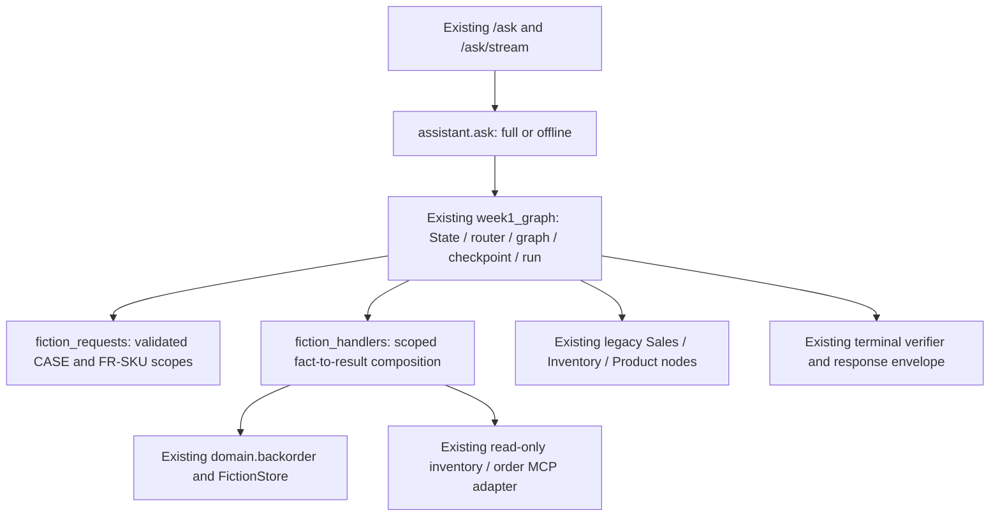

# RetailIQ — Basic Design & Detail Design

**Status (2026-11-05):** this document owns shared flow boundaries; legacy/local paths remain active alongside Fiction. Fiction M0 [#33](https://github.com/hungtvb/retailIQ/pull/33), scoped T04 read-only stdio MCP [#46](https://github.com/hungtvb/retailIQ/pull/46) and **UC-01 T02 G1 actual LLM on pinned Fiction release** ([live run 41776582027](https://github.com/hungtvb/retailIQ/actions/runs/41776582027)) have passed their specific acceptance gates. T03 committed-session follow-ups are fixture-verified. Scoped T05 policy explanation is implemented and provider-verified; see the [UC-01 evidence ledger](CAPABILITY_LEDGER.md#scoped-uc-01-evidence). **Broader Fiction planning, general RAG/5,003-document Chroma, HITL, browser E2E and legacy migration remain open.** Use the reviewed/merged [UC-01 Implementation Detail](implementation/UC-01-backorder.md) for that use case; no design PR or outdated fixture result substitutes for executable evidence.

[Product](PROJECT.md) · [Requirements](REQUIREMENTS.md) · [Architecture](ARCHITECTURE.md) · [Data and API contracts](DATA_API.md) · [Capability status](CAPABILITY_LEDGER.md)

## Basic Design — boundaries and responsibilities

**User job:** ask retail inventory/sales/product questions, follow up within a session, and inspect sources or workflow evidence. Human review remains required for any sensitive business decision.

| Boundary | Implemented source | Responsibility / trust boundary |
|---|---|---|
| User interface | `web/`, `frontend/` | Chat and execution graph **presentation**; graph visuals do not execute agents |
| HTTP API | `retailiq/api/` | Request validation, chat/session and local workflow endpoints; not an enterprise identity boundary |
| Assistant selection | `retailiq/assistant.py` | Explicit offline deterministic vs full-mode execution |
| Chat orchestration | `retailiq/orchestration/week1_graph.py` | LangGraph router, domain specialists, handoff, optional scoped supervisor and checkpointer |
| Domain decisions | `retailiq/domain/analytics.py`, `retailiq/queries.py`, `retailiq/domain/semantic.py` | Reviewed business definitions and read-only SQL; LLM does **not** write unrestricted SQL |
| **Fiction M0 domain (merged)** | `retailiq/domain/fiction.py`, `retailiq/infrastructure/sqlite.py`, `data/fiction/manifest.json` | **Release-verified** read-only Fiction facts; UC-01 explicit CASE-ID full-mode chat path is wired via #40; other business intents remain legacy. Real SQLite binary stays outside Git |
| Product knowledge | `retailiq/retrieval.py`, `retailiq/rag/` | Offline lexical search or full-mode hybrid/vector retrieval, sourced generation and grounding |
| Data and sessions | `retailiq/infrastructure/` | Synthetic SQLite facts, local session/history, opt-in scoped preference memory |
| MCP | `retailiq/mcp_server.py`, `retailiq/mcp_adapter.py` | Local stdio inventory/order operations; not an external retail API |
| Workflow graph | `retailiq/domain/workflow_demo.py`, `retailiq/api/workflows.py` | Deterministic scenario execution, recorded steps and simulated manager review; **separate from LangGraph chat execution** |
| Observability/evaluation | `retailiq/observability.py`, `scripts/`, optional provider tracing | Distinguish local events, tests, simulated graphs and real model traces |

### Two execution surfaces (do not conflate)

~~~mermaid
flowchart TD
    U[Retail operator] --> UI[Chat / Workspace UI]
    UI --> C[Assistant HTTP endpoints]
    UI --> W[Workflow endpoints]
    C --> M{RETAILIQ_MODE}
    M -->|offline| D[Deterministic lookup]
    M -->|full| G[LangGraph router and specialists]
    D --> S[Reviewed SQL / offline lexical]
    G --> S
    G --> R[Product RAG / LLM where needed]
    W --> F[Deterministic workflow_demo]
    F --> A[Local review record - simulated role]
    S --> E[Evidence and validated answer]
    R --> E
    E --> UI
    F --> V[Recorded events -> graph view]
    V --> UI
~~~

**Execution truth:** the Workspace graph reflects events returned by workflow APIs. A displayed specialist node or control-transfer edge in `workflow_demo.py` is not proof of an independently invoked agent. Actual LangGraph/subagent actions must be evidenced separately.

### Change locality — coding-agent navigation

Read `AGENTS.md` and the [documentation index](README.md) first. Start at the **entrypoint for the requested behavior**, follow its imports, and load only the relevant contract and tests. This table is a source-navigation aid, not a new architectural layer or a claim of test success.

| Task | Inspect first, then follow dependencies | Focused verification |
|---|---|---|
| Incorrect stock/revenue/rank or scoped follow-up | `retailiq/queries.py`, `domain/revenue_plan.py` → `domain/analytics.py` → `infrastructure/sqlite.py` | `python -m scripts.audit_queries --mode offline --strict`; compare exact SKU/period/channel with independent SQL oracle |
| Chat routing, agent handoff, streaming errors | `api/http.py` → `assistant.py` → `orchestration/week1_graph.py` and `orchestration/agents.py` | Relevant `pytest` scenario, then scripted query and SSE/browser acceptance for the affected path; report mode |
| Product document parsing, RAG or citations | `retrieval.py` → `rag/indexing.py`, `rag/advanced_retrieval.py`, document loaders | Parser/index tests; `scripts/eval_retrieval.py` is a separate quality exercise, not automatic live-provider PASS |
| Inventory freshness and local MCP | `api/workflows.py` → `domain/freshness_routing.py`, `mcp_adapter.py`, `mcp_server.py` | `python -m scripts.audit_freshness --strict`; local stdio: `python -m scripts.smoke_mcp_stdio` |
| Workflow graph and simulated approval | `api/workflows.py` → `domain/workflow_demo.py` | `python -m scripts.audit_workflows --strict`; do **not** confuse scenario events with actual LangGraph/A2A execution |
| Workspace/chat graph display | `frontend/src/main.tsx`, `frontend/src/graph.ts`; **legacy** `web/assets/app.js` belongs to `/`, not `/workspace` | `npm --prefix frontend run build` and applicable Chromium smoke; graph displays observed events only |
| Session history, consent and traces | `api/sessions.py` → `infrastructure/sessions.py`, `domain/customer_memory.py` | `python -m pytest -q tests/test_customer_memory.py` plus relevant HTTP/session negative case |

**Deployment boundary:** local demo requires `workers=1`; SSE capacity, session locks and JSONL logging are per process.

**Compatibility boundaries:** `retailiq/analytics.py` re-exports `domain.analytics`; `retailiq/api/__init__.py` preserves the `uvicorn retailiq.api:app` entrypoint. Keep these paths unless callers/tests are explicitly migrated. `orchestration/week1_graph.py` is an existing source filename, **not** a cue to create new `weekN_*` packages. The two frontend implementations and the deterministic workflow simulator are **intentional independent surfaces**; don't merge or rewrite them simply to reduce the file count. Large source files alone are not a reason to add frameworks or abstractions.

## Fiction target design and implementation ownership (from 2026-11-03)

**Implemented now:** `FictionStore.open()` validates the pinned unified SQLite release; `fulfillment_case()`, `order()`, `inventory()`, `top_sellers()`, `refund()` return scoped **read-only facts** with source IDs, limitations and temporal information. See [Fiction Runtime](FICTION_RUNTIME.md), [PR #33](https://github.com/hungtvb/retailIQ/pull/33) and [#31](https://github.com/hungtvb/retailIQ/issues/31). UC-01 explicit CASE-ID reaches `/ask` via a fixed graph path, including **provider-backed real-release G1** acceptance on [run 41776582027](https://github.com/hungtvb/retailIQ/actions/runs/41776582027). Scoped T05 adds verified policy explanation; neither gate establishes generalized Fiction planning or broad corpus RAG.

**Approved architecture / remaining implementation:** Reviews 01–10, tracked by [#21–23](https://github.com/hungtvb/retailIQ/issues/23) and [#26–30](https://github.com/hungtvb/retailIQ/issues/30), require verified-first execution: committed context (#22), bounded capability plan (#23), shared SQL/MCP (#26), sourced policy RAG (#27; scoped T05 implemented/verified, broader corpus open), evidence fitness (#28), authenticated HITL (#29), and truthful event-driven UI (#21/#30). Do not present a deterministic workflow illustration as actual Agent execution.

**Next design work:** [UC-01](implementation/UC-01-backorder.md) is already an approved and partially implemented use case, with T06–T08 still open in [parent #34](https://github.com/hungtvb/retailIQ/issues/34). [Refactor R1 #51](https://github.com/hungtvb/retailIQ/issues/51) is merged; its limited Fiction boundary extraction is described below. Future UC details are written just in time; shared decisions remain here and in [Data/API](DATA_API.md).

**Important separation:** legacy flows below are a record of **existing behavior** using the old retail fixture (`EL-###`, VND, completed-order semantics); they are **not** the Fiction target contract (Fiction product UUID/FR-SKU, USD, delivered orders and time-qualified policy). Do not reuse legacy business semantics without explicit validation.

## Existing legacy request and decision flows (not Fiction UC-01 acceptance)

### DD-01 — Structured retail question (CAP-01, CAP-04, CAP-07)

**Entry:** chat request (documented `POST /ask` / streaming counterpart) with question and optional session/history.

1. `assistant.ask()` selects offline execution unless `RETAILIQ_MODE=full`; offline answers must identify deterministic mode.
2. Full mode invokes `orchestration/week1_graph.py`: route intent and bounded user-authored follow-up context to Sales, Inventory, Product, Supervisor or general chat.
3. Sales and Inventory specialists use `orchestration/agents.py` and reviewed `queries.do()`/`domain.analytics` functions; the selected metric, SKU, period and location must not be silently changed.
4. Graph returns structured answer, records, sources/contexts, active agent and relevant handoff/subagent metadata; UI renders these without treating metadata as verification.
5. Unresolvable/ambiguous product, missing facts, invalid stock or mismatched business scope must result in a qualified response or error, never a fabricated numeric answer.

**Specific guardrails:** `inventory.available = on_hand - reserved`; revenue uses completed orders and line discounts; top-seller ranking uses completed-order units. Consult `DATA_API.md` for the exact business contract. Follow-up handling is bounded and **not** certified for arbitrary natural-language references.

### DD-02 — Product document question (CAP-02, CAP-05, CAP-10)

- In offline mode, `retrieval.lexical()` searches parsed local document chunks, **not** embeddings or vector DB.
- In full mode, `retrieval.retrieve()` uses `RETAILIQ_RAG_RETRIEVAL=hybrid` (default) or `vector`; ingestion/indexing and embeddings are in `retailiq/rag/`.
- `agents.product_analysis()` builds untrusted-source evidence; the LLM may answer only from this evidence and must supply checked source labels. Invalid/missing citations fail closed.
- Catalog fields such as current price and structured inventory come from reviewed source data, **not** arbitrary document chunks.
- Provider-backed RAGAS/trace results require an actual current-commit run. Parser tests, mocked embeddings and offline lexical search are not equivalent acceptance.

### DD-03 — Cross-source replenishment review (CAP-03, CAP-04)

- Router selects `retail_supervisor` for explicit replenishment decisions; not every stock + sales question should trigger a purchasing recommendation.
- `agents.replenish_review()` defaults to a model-directed supervisor (`RETAILIQ_SUPERVISOR_MODE=agentic`); `deterministic` mode builds two scoped LangGraph SQL subagents.
- Sales identifies ranked SKU from completed orders. Inventory is requested **for that same SKU**; `review_from_evidence()` rejects missing/mismatched SKU or inconsistent availability.
- Current priority rule compares available units against units sold; it is a **screening heuristic**, not demand forecasting or an automatic purchase order.
- To claim a model-directed run, collect its actual invocation/trace. The deterministic path proves only its own execution and business checks.

### DD-04 — Freshness, MCP and the graph workspace (CAP-06–08, CAP-11, CAP-14–15)

- `POST /api/workflows/freshness/route` validates metric and requested freshness tier. Inventory optionally executes an actual local stdio MCP re-read when `RETAILIQ_WORKFLOW_USE_MCP=1`; mismatched SQL/MCP values fail.
- Other synthetic sources lack trustworthy refresh timestamps; a routing decision is **UNVERIFIED** freshness, not live data. Multi-source `/freshness/question` can return `REQUIRES_ORCHESTRATION` without executing tools.
- `POST /api/workflows/run` uses `domain/workflow_demo.py` for labeled synthetic scenarios. `GET /api/workflows/runs/{run_id}` returns the stored run and recorded steps.
- `POST /api/workflows/runs/{run_id}/review` accepts a caller-supplied analyst/manager role to simulate approve/reject. **There is no authenticated manager identity**, real row-level authorization or production order/price mutation.
- Do not describe the five displayed Week 4 roles as five independent autonomous agents or interoperable A2A until actual interfaces and handoff execution are demonstrated.

### DD-05 — Session, failure and evidence boundaries (CAP-04, CAP-09, QUAL-02–07)

- Chat sessions and optional consented preferences are local and scoped. A session UUID is **not** authenticated customer identity; revocation and deletion are required boundaries.
- Retry only transient failures on safe idempotent reads; do not retry sensitive mutations or disguise a provider failure as a factual answer. Keep model context bounded.
- Logs, graph events and screenshots show what was recorded, **not** automatically that a business answer is correct. Preserve source/freshness IDs and exact execution mode.
- Keep secrets and generated traces/reports out of Git. Source tests/fixtures and definitions remain version-controlled.

## Acceptance mapping — representative negative and positive cases

| Design slice | Required scenario / failure | Evidence mode and source |
|---|---|---|
| Structured answer | Stock, revenue, ranking; missing/mismatched SKU, time or location; independently verified totals | Local SQL + business scenario oracle; `docs/SCENARIO_ACCEPTANCE.md` |
| Conversation | Same product/period across follow-up; no session leakage; ambiguous reference clarified | Session + graph scenarios; no claim of full open-ended dialogue reliability |
| Product RAG | Correct citations; empty/invalid source; stale index; injected document instructions | Index/grounding tests, then separately **provider-backed** retrieval and RAGAS |
| Multi-source supervisor | Sales-ranked SKU equals inventory SKU; no guessed numbers or purchase write | Scoped graph/subagent events plus negative-case oracle |
| Freshness/MCP | Expired/unknown refresh time; real stdio transport; SQL/MCP disagreement | Local routing/MCP audits; live retailer freshness still pending |
| HITL and multi-agent | Rejection, unauthorized actor, replay/resume, actual transfer and safe finalization | Current local scenario is **simulation only**; authenticated approval gate remains open |

**Evidence contract:** report commit SHA, execution mode, exact command/input, independent expected result, observed output and any remaining gap. Consult the [capability acceptance ledger](CAPABILITY_LEDGER.md) for status; a requirement appearing above does **not** mean it passed.

### Design-first change policy

- **Stable design is versioned code-adjacent documentation:** shared principles live in `ARCHITECTURE.md`/`DESIGN.md`/`DATA_API.md`; use-case-specific implementation detail lives in `docs/implementation/UC-XX-*.md`. `docs/README.md` is the index. No parallel Basic/Detail document hierarchy or duplicate design pasted into Issues.
- **Approve before feature code:** design PR reviewed and merged to `main` first; the implementation issue links the **approved path and design commit SHA**; code PR names the issue, requirement and design version and shows deviations and evidence. A design **draft** is not an implementation contract yet.
- **If code reveals a substantive gap** (business metric, source authority, time applicability, tool scope, trust boundary): stop the affected change and update/review design **before implementing the new behavior**. A typo or strictly compatible explanation can be updated alongside a code PR.
- **Ownership:** docs define the normative design; GitHub Issues track work and acceptance; PRs record review, diff and test mode; CI artifacts/traces carry execution evidence. The capability ledger records only actually proven statuses. Wiki explains rationale without copying contracts. No hardcoded success claims from merged docs alone.

## Design constraints and change policy

1. **Reuse existing paths:** do not create a parallel agent runtime, repository layout, task engine or new abstraction just to match this document.
2. **Smallest truthful design:** diagrams and descriptions must match actual execution, with simulated and provider-backed paths labeled independently.
3. **One source of truth:** Product/Requirements own goals; this Design owns flow boundaries; `DATA_API.md` owns metrics/contracts; the capability ledger owns acceptance status.
4. **Future change:** update the relevant flow and acceptance scenario with the code change, not an unrelated pile of documents. Record substantial architectural trade-offs as short wiki/decision notes when needed.

## Refactor R1 — isolate Fiction orchestration (issue #51)

**Design gate:** based on `main@ae9fe6549357a7ab36152a51311b50fc2c528175`, reviewed in [PR #52](https://github.com/hungtvb/retailIQ/pull/52). **This design is approved only once PR #52 is merged to `main`;** code PRs must cite that exact merge SHA. Design approval does not imply implementation or acceptance. Objective: maintainability/source isolation before T05, with **no behavior, trust policy, source semantics, graph topology or HTTP contract change**.

### Why this slice, not a full rewrite

- `retailiq/orchestration/week1_graph.py` is 923 lines and owns router, legacy nodes, Fiction request rules, Fiction backorder/inventory handlers, state, compilation, checkpoint lifecycle and final validation. Legacy uses `EL-###`/VND/completed-order semantics; Fiction uses verified UUID/`FR-` SKU/USD/case-cutoff policy. Their business data must never fall back across domains.
- Existing callers include `retailiq/graph.py` (compatibility `run` re-export), `retailiq/assistant.py` (offline/full), `retailiq/api/http.py` (the two scope exceptions), and `retailiq/api/sessions.py` (checkpoint cleanup). Tests patch `week1_graph.chat_model`, `_fiction_store_cached`, `_uc01_inputs`, `build_graph`, and legacy agent functions directly. Extraction must keep those observable seams.
- **Keep the existing single LangGraph**: extracting pure helpers is sufficient. No separate Fiction graph/agent runtime, framework, registry, dependency-injection container, context store or migration of the two UIs.

### Approved target *if this proposal is merged*

- **R1-A — pure request boundary:** move only `_fiction_inventory_request`, `_uc01_followup_kind`, `_case_id_for_uc01` plus their regex/constants and shared exception identities into `retailiq/orchestration/fiction_requests.py`. Re-export/adapt original names in `week1_graph.py` so existing API and direct tests retain the same exception classes and call points. The `route` function itself and its real `chat_model`/fallback behavior stay in `week1_graph.py`; it never accepts LLM-supplied business identifiers.
- **R1-B — execution boundary:** move the fact-to-answer/state-update logic of `fiction_inventory_agent` and `backorder_agent` to `retailiq/orchestration/fiction_handlers.py`. Keep both **existing named node wrapper functions** in `week1_graph.py`; wrappers resolve trusted store/config/actual MCP call at execution and call the new handlers with explicit, narrow inputs/callables. Handlers do **not** import `week1_graph`, build graphs, own global state, or decide policy eligibility. The wrapper retains `Command(update=..., goto='retailiq_reply')`, node names, source/cutoff checks, `capability.selected` and observed `tool.sql.*`/`mcp.tool.*` semantics; no extra invocation or silent fallback.
- **Unchanged ownership:** `domain/fiction.py` and `domain/backorder.py` remain authoritative for identity, stock arithmetic, policy effectiveness, source SHA and disposition. `week1_graph.py` retains `State`, `AGENT_FOR_INTENT`, legacy nodes, LLM router, `build_graph`, `run`, graph-result validation, existing SQLite checkpoint cache/close/delete, public constants and test seams. `retailiq/graph.py` remains the compatibility shim; HTTP API/session/SSE remain untouched unless a narrowly verified import adjustment is necessary.

**Maintainability acceptance (not a line-count KPI):** the new Fiction modules must not import `week1_graph.py`, legacy `queries.py` or `domain.analytics.py`; `week1_graph.py` should retain graph ownership but no longer contain Fiction-specific response formatting and scope-validation rules. Do not introduce duplicated event logging, duplicate policy checks or pass-through wrappers that increase coupling. If R1-B fails this locality test, stop after the verified R1-A PR and re-review the design instead of forcing the split.

### External contract and regression oracle

| Boundary | Must remain identical |
|---|---|
| HTTP + session | `/ask`, `/ask/stream`, response fields, errors 422 for invalid case/Fiction scope, request/session IDs, bounded history, committed case binding, checkpoint deletion and event timing |
| LangGraph | Node names/edges, retries (idempotent SQL only), recursion limit 12, `Command` routing, fallback classification, no ghost MCP/agent events |
| Fiction G1–G3 | Pinned release/source SHA, explicit CASE ID, order/item/product, evidence cutoff, snapshots, exact policy SHA, `NEEDS_REVIEW`/`NOT_REQUESTED`; no transfer/order/stock writes |
| Fiction inventory/MCP | FR-SKU/warehouse scope, undated-stock limitation, reject ambiguous/multi-intent/temporal questions, actual stdio tool identity and error propagation; no legacy-source fallback |
| Legacy | Existing offline/full Sales/Inventory/Product/revenue/handoff/retry behavior preserved; no removal based on filename or line count |

### Implementation gates (separate code PRs; never commit on main)

1. **Design approval:** review/merge this proposal; link final design commit in [#51](https://github.com/hungtvb/retailIQ/issues/51) and code PRs. No code edits before this gate.
2. **PR R1-A:** extract only request parsing and original exception identity, add targeted negative and import-compatibility tests. Relevant regression CI PASS before any second extraction; review before merge.
3. **PR R1-B:** extract only Fiction handlers using explicit narrow arguments; preserve wrappers and test monkeypatch seams or migrate a test only after verifying it represents the same runtime behavior. Observe exact SQL/MCP invocation and trace; review before merge.
4. **Acceptance:** run existing Python tests, business audits, real-MCP stdio, API/SSE/browser regression as applicable; source-backed Fiction G1 oracle on pinned release. After final code merge run the manually dispatched, secret-scoped `Live LLM Acceptance suite=uc01` on **the new main commit**. Compare model route (`route_fallback=false`), G1 SQL/policy oracle, events, source SHA, disposition and no-write contract against [pre-refactor live run 41776582027](https://github.com/hungtvb/retailIQ/actions/runs/41776582027). **Old live PASS is not evidence for new code.**
5. **Stop/rollback:** if an extraction changes business semantics, evidence lineage, session isolation, checkpoint ownership or observable route/tool edges, revert the affected PR slice; review a separate behavior-changing design rather than broadening this refactor. No unnecessary full CI for documentation-only updates.

**Explicitly deferred:** remove legacy analytics/fixture after Fiction replacement UCs, MCP SDK migration, dynamic planner #23, policy RAG T05, authenticated HITL T06, product UI consolidation, new agent infrastructure and ROI optimization. These are **not hidden work in R1**.

**Technical reference:** [LangGraph Python Graph API checklist](https://docs.langchain.com/oss/python/langgraph/use-graph-api) — shared state, `Command` control transfer and runtime dependency boundaries; no new LangGraph API or version upgrade is proposed.
