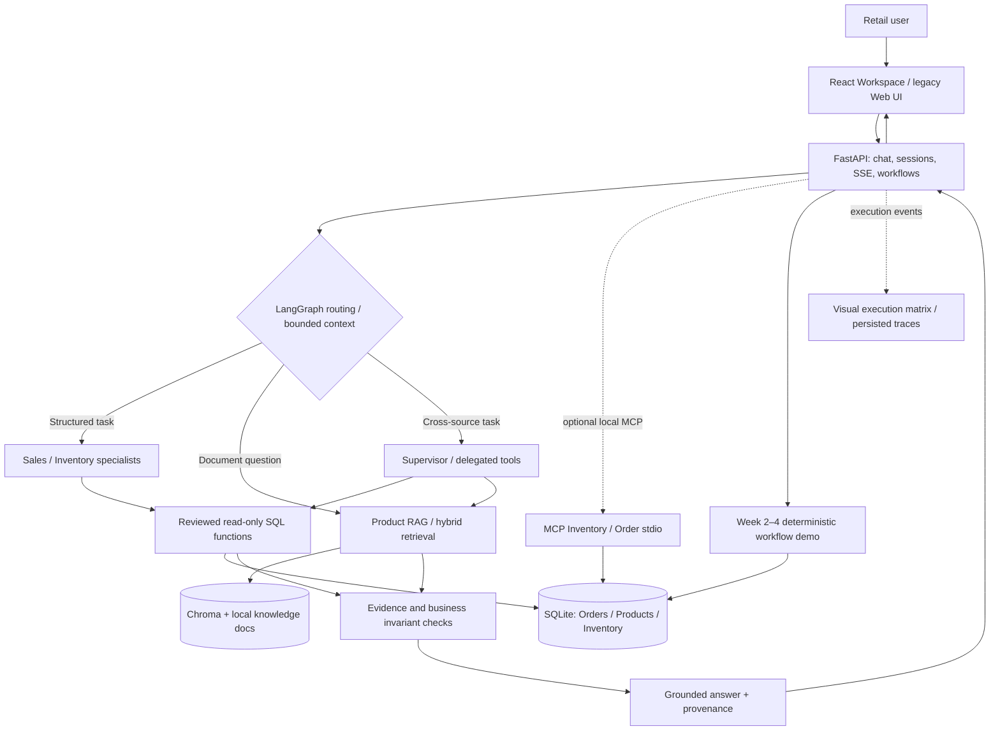

# RetailIQ — High-Level Project Overview & Assessment

> **Version:** 1.0 · **Updated:** 31/10/2026 · **Baseline:** main @ `25b5a2a7dd23b1521b88438b62f7967ffe989958`  
> **Domain:** Retail / E-commerce — B2C Electronics & Accessories  
> **Audience:** Nhóm 5 thành viên, trainer, người tiếp quản dự án  
> **Evidence mode:** Local synthetic / mocked; provider-backed evidence cũ được ghi rõ riêng.  
> **Mục đích:** Một trang định hướng xuyên suốt *Business → Needs → Design → Implementation → Tests → Evaluation*. Chi tiết kỹ thuật và yêu cầu gốc vẫn nằm ở các tài liệu chuẩn được dẫn liên kết cuối trang.

## 1. Executive summary

**RetailIQ là Retail Decision-Support Copilot**, giúp nhân viên vận hành bán lẻ đặt câu hỏi bằng ngôn ngữ tự nhiên, kết hợp dữ liệu giao dịch, tồn kho và tài liệu sản phẩm/chính sách, rồi nhận câu trả lời có căn cứ để tự đưa ra quyết định.

Ba mục tiêu: **Faster · Easier · Reliable**. Đây vẫn là **business hypotheses**, chưa phải hiệu quả đã được đo. RetailIQ **không nhằm thay thế** ô tìm kiếm giá, báo cáo POS hay màn hình kiểm tồn kho đơn giản: những tác vụ đó có thể nhanh hơn khi dùng phần mềm sẵn có. Giá trị cần chứng minh là các **công việc đa bước, đa nguồn, cần đối chiếu số liệu và quy tắc nghiệp vụ**.

**Trạng thái sau merge:** Nhánh `feature/product-workspace-v1` (bao gồm lịch sử `feature/four-week-graph-workflows`) đã được tích hợp vào `main` qua [PR #10](https://github.com/hungtvb/retailIQ/pull/10). Có SQL/RAG chat, React workspace, execution graph, MCP local, và các demo workflow Week 2–4. Tuy nhiên, các workflow phê duyệt/5 vai trò ở Week 3–4 chủ yếu là **deterministic simulations**, không phải kết quả production hay 5 autonomous agents.

## 2. Business problem

### 2.1 Bối cảnh và vấn đề

Trong môi trường bán lẻ, một công việc có thể đòi hỏi dữ liệu từ nhiều công cụ: POS/OMS (đơn, doanh thu), ERP/WMS (tồn kho), PIM/catalog (SKU, giá, thuộc tính) và tài liệu chính sách. Người dùng phải chuyển màn hình, chọn bộ lọc, đối chiếu ID/số liệu rồi tự tổng hợp kết luận.

**Problem statement:** Nhân viên có thể mất công sức khi tổng hợp và kiểm chứng thông tin từ nhiều hệ thống để xử lý một **quyết định nghiệp vụ**, nhất là khi câu hỏi có điều kiện về thời gian, sản phẩm, địa điểm hoặc chính sách. Đây là giả thuyết vận hành, **chưa được xác nhận bằng phỏng vấn khách hàng thực**.

**Phản biện trainer được tiếp thu:** “Giá sản phẩm A?” hoặc “SKU B còn bao nhiêu?” là tra cứu đơn lẻ; không đủ làm luận cứ cho Agentic AI. Nếu một SQL query/dashboard trả lời đầy đủ thì ưu tiên cách đó, không ép qua nhiều agent.

### 2.2 Người dùng và công việc cần giải quyết

| Persona | Business need / job-to-be-done | Kết quả có ích |
|---|---|---|
| Store operations staff | Tra cứu đúng SKU/tồn kho; xử lý ngoại lệ theo điều kiện | Thông tin đáng tin, ít chuyển màn hình |
| Store/retail manager | Hiểu diễn biến doanh thu, sản phẩm và hoạt động theo kỳ/địa điểm | Phân tích nguyên nhân có số liệu |
| Inventory/sales analyst | Tìm nguy cơ hàng bán chạy sắp hết, đối chiếu doanh số/tồn kho/quy tắc | Danh sách ưu tiên kèm lý do và nguồn |
| Order operations manager (mở rộng W3–W4) | Đánh giá phương án fulfilment/pricing/order và phê duyệt nhạy cảm | Báo cáo đề xuất, verification và dấu vết phê duyệt |

### 2.3 Business outcomes và cách đo

| Outcome | KPI cần đo | Điều kiện |
|---|---|---|
| **Faster** | End-to-end **time to correct, checked answer** so với workflow thủ công | Tính cả thời gian sửa sai, xác minh và LLM latency |
| **Easier** | Số bước/click/screen switch, mức dễ sử dụng 1–5 | Cùng nhiệm vụ, cùng dữ liệu, người thử thực hiện trực tiếp |
| **Reliable** | Correctness theo SQL oracle; policy citation; từ chối khi thiếu/không rõ dữ liệu | Không suy diễn tồn kho từ docs; không bịa “live” hoặc source freshness |

**Chưa có** user study/baseline thực tế, đo cải thiện thời gian thao tác, ROI hay acceptance của trainer cho các use case ra quyết định.

## 3. Business needs & phạm vi

**Nhu cầu bắt buộc:** (a) dữ liệu bán hàng/tồn kho theo SKU, kỳ, địa điểm, trạng thái; (b) truy xuất tài liệu sản phẩm/chính sách có nguồn; (c) kết hợp thông tin khi cần; (d) chuẩn hóa định nghĩa KPI; (e) kiểm chứng và xử lý ambiguity, missing/stale data; (f) log/trace để giải thích quyết định.

**Trong phạm vi hiện tại:** Local-only, dữ liệu synthetic, read-only analytics, tài liệu RAG local, chat follow-up có giới hạn, graph hiển thị bằng chứng execution, MCP local optional, approval/order **simulation** cho học tập.

**Ngoài phạm vi đã chứng minh:** Tích hợp POS/ERP/WMS production, tồn kho live SLA, ghi đơn hàng thật, đổi giá thật, RBAC production, autonomous agent-to-agent production, business savings đã đo.

### 3.1 Scenario design — từ lookup đến decision support

| Cấp | Câu hỏi / workflow | Lợi ích và kỹ thuật |
|---|---|---|
| **Baseline (W1, đơn giản)** | “Giá SKU A?”; “Còn bao nhiêu hàng?”; “Top sản phẩm tháng 10?” | Kiểm tra data access, routing, SQL, RAG; **không** coi là bằng chứng business value |
| **Cross-source (ưu tiên cải thiện)** | “Top 5 sản phẩm bán chạy có nguy cơ thiếu hàng ở từng địa điểm? Phân loại theo dữ liệu hiện có và nêu điều kiện chưa chắc chắn.” | Kết hợp sales + inventory, exact SKU/period/location, kiểm chứng; tránh tự giả định nhu cầu/lead time |
| **SQL + RAG (ưu tiên)** | “Sản phẩm bán chạy tồn kho thấp nào phù hợp quy tắc ưu tiên nhập hàng trong tài liệu chính sách?” | SQL facts + policy retrieval + dẫn nguồn; tài liệu chính sách phải khớp dataset |
| **Governed workflow (W3–W4)** | “Đề xuất xử lý đơn khó fulfil; kiểm tra stock, price, rule và chuyển manager duyệt.” | Phân trách nhiệm, verification, HITL; **không** biến đề xuất thành thao tác thay đổi dữ liệu mà không có quyền |

**Flagship scenario đề nghị:** *Inventory Risk & Action Review* — phân tích sản phẩm bán chạy, tồn khả dụng, ngưỡng và chính sách. Chỉ đưa ra “ngày đủ hàng” hoặc lượng nhập đề nghị khi có dữ liệu và business rule đủ để tính. Đây là **đề xuất scenario**, chưa có test chứng minh trọn vẹn.

## 4. Data model, source-of-truth & RAG

**Fixture đang chạy** (`scripts/seed.py`): khoảng **10 products, 3 locations, 30 inventory records, 120 orders**, ngày tham chiếu mặc định 2026-10-28. SQLite lưu `products`, `locations`, `inventory`, `orders`, `order_lines`; thư mục tài liệu local phục vụ RAG. **Chưa import Olist, TheLook, Fiction Retail hay dataset Kaggle khác vào hệ thống hiện tại.**

| Logical source | Dữ liệu/định nghĩa | Giới hạn |
|---|---|---|
| Sales / OMS | Order status = completed, quantity, unit price, line discount; doanh thu theo kỳ | Không có return/refund hoàn chỉnh và dữ liệu production |
| Inventory / WMS | `available = on_hand - reserved` theo SKU/location; timestamp snapshot | Timestamp có thể stale; không chứng minh live |
| Product catalog / PIM | SKU, catalog name, category, list price, product attributes | Dữ liệu synthetic, giá niêm yết khác realized sales |
| Product knowledge / RAG | Local MD/PDF/DOCX... → chunk/index → retrieval → nguồn | Không phải source-of-truth cho stock hoặc order; provider quality chưa re-evaluate trên merged SHA |
| Conversation/trace | SQLite session, bounded context và allowlisted execution metadata | Không có identity/authentication production |

**Định hướng dataset tiếp theo:** Audit độ phủ của dataset public có đủ **orders + product + inventory + textual knowledge**; duy trì ID liên kết thống nhất. Phần thiếu phải gắn nhãn synthetic. Không ghép reviews/policy từ dataset khác khi không có mapping tin cậy.

## 5. Architecture — current implementation

**Hai con đường cần phân biệt:** (1) **Chat orchestration** dùng LangGraph trong full mode, offline có fallback deterministic; (2) **Week 2–4 workflow API** dùng các bước mô phỏng deterministic có trace, *không chứng minh 5 LLM agents thực sự giao tiếp*. Execution graph là **visualization của event đã ghi nhận**, không phải cơ chế orchestration mới.

**Nguyên tắc xử lý:** 
- Simple intent → một domain tool, tránh vòng agent thừa.
- Compound intent → supervisor/tác vụ phụ thuộc; chuyển đúng **SKU, period, location** qua các bước.
- SQL dùng query được review và tham số hóa; không cho LLM thực thi SQL tùy ý.
- Document facts → retrieval kèm source; metric/stock facts → SQL authoritative.
- Skill được *selected/loaded* không đồng nghĩa được *LLM thực thi đúng*; graph không dựng MCP/handoff giả.

**Trách nhiệm chính trong code:** `retailiq/api/http.py` (HTTP/SSE), `retailiq/orchestration/week1_graph.py` (router/handoff), `retailiq/domain/analytics.py` (KPI/SQL), `retailiq/rag/` (retrieval), `retailiq/mcp_server.py` + `mcp_adapter.py` (MCP), `retailiq/domain/workflow_demo.py` (simulated Week 2–4), `frontend/` (React workspace).

## 6. Tech stack và lựa chọn

| Layer | Stack đang dùng | Lý do / lưu ý |
|---|---|---|
| Runtime/API | **Python 3.12, FastAPI, Pydantic** | Local API, validation, SSE |
| Agent orchestration | **LangGraph, LangChain** | State graph, router/specialists, vetted tools; khác offline deterministic |
| LLM & embeddings | OpenAI-compatible chat/embedding provider | Cần credentials và provider-backed evidence riêng |
| Structured data | **SQLite** | Seed reproducible, read-only data/business oracle |
| Product RAG | **Chroma, LangChain retrievers**, lexical/hybrid & reranking logic | Index local; provider retrieval metric chưa chứng minh trên merged revision |
| MCP | **FastMCP + LangChain MCP adapter, stdio local** | Real transport test có, không phải enterprise service |
| Frontend | **React 19 + TypeScript + Vite** (`/workspace`), legacy HTML/JS (`/`) | Chat-first UI và SVG execution matrix |
| Tests | **pytest, Node test runner, Playwright/Chromium** | Unit/integration/HTTP/browser; cần thêm business evaluation |
| Observability/eval | JSONL/SSE, **LangSmith, RAGAS** | Có lịch sử evidence; merged revision cần live rerun |
| Planned/partial W3 | Langfuse, DeepEval, governance controls | Không tuyên bố đã đạt nếu chưa có trace/report thực |

Không cần triển khai microservices, cloud, event broker, vector infrastructure riêng hoặc nhiều bộ agent orchestration để demo khóa học.

## 7. Course roadmap & hiện trạng sau merge

| Milestone | Required focus | Tình trạng đã kiểm tra | Gap quan trọng |
|---|---|---|---|
| **Week 1** | LangGraph, SQL, product RAG/Chroma, RAGAS, LangSmith | SQL/compiled graph và local tests PASS; có lịch sử live evidence 29/10 | Live RAGAS/LangSmith/full-provider end-to-end trên bản merge **chưa được xác nhận** |
| **Week 2** | Freshness, semantic layer, Inventory/Order MCP, memory, advanced retrieval, reliability | Semantic + local MCP/freshness tests PASS; session memory và hybrid retrieval có code/tests | Live freshness SLA, authenticated persistent customer identity, retrieval quality thực tế |
| **Week 3** | HITL, RLS, KPI alerts, cost, Langfuse, DeepEval, security/PromptOps | Local simulated approvals, scope và threshold tests; cost estimate | Authenticated reviewer, real interrupt/resume, Langfuse/DeepEval evidence, security review |
| **Week 4** | Five specialist agents, A2A-style coordination, verification, report, manager-approved order | Local five-role deterministic trace, allocation checks, no-write gates | **Five actual agents** + typed communication, real control transfer/verification/approval under tested authority |

**Pattern ownership:** Router/Handoff/Subagent/Skill/Custom Workflow xuất hiện trong code và test ở mức tương ứng. Không đồng nhất “graph node”, “tool call”, “deterministic role” với một autonomous AI agent.

## 8. Test strategy & integration evidence

**Merge trace:** [PR #10](https://github.com/hungtvb/retailIQ/pull/10) · integrated CI [41168489613](https://github.com/hungtvb/retailIQ/actions/runs/41168489613) · localhost E2E [41168489617](https://github.com/hungtvb/retailIQ/actions/runs/41168489617). CI chạy trên integration commit `81c1e26ae923`; final merge `25b5a2a7dd23` chứa cùng changes và có main push CI riêng.

| Verification gate | Evidence trên integration CI | Ý nghĩa đúng |
|---|---|---|
| Python regression + compiled graph | **387 pytest PASS** | Verified local contracts, không phải provider accuracy |
| Business query acceptance | **32/32 PASS** | Offline synthetic fixtures / independent oracles |
| Week workflow audit | **19/19 PASS** | Deterministic workflow, API + SQL oracle |
| Edge/adversarial | **14/14 PASS** | Ambiguous reference, invalid data, blocked states |
| Freshness | **10/10 PASS** | Local timestamp/policy contract, không phải live SLA |
| Documentation links | **15 active docs, 95 links, 0 errors** | Hợp lệ tại CI SHA trước khi thêm tài liệu này |
| Frontend/Chromium | PASS | React build, local FastAPI/SSE/browser workflow |
| MCP stdio + browser | PASS | Real *local* MCP tool transport, không phải remote production |
| Localhost benchmark | PASS | Synthetic benchmark; không thay thế user value study |

**Giới hạn chất lượng:** 32 business cases do team chọn không đại diện mọi câu hỏi thực tế; kết quả offline không chứng minh LLM full-mode trả lời tương đương. RAGAS 3 cases và LangSmith traces từ **29/10** là bằng chứng lịch sử, không thể chuyển thành PASS của commit mới. Không có end-user Faster/Easier benchmark hoặc measured ROI.

### 8.1 Các lớp test tiếp theo

1. **Data correctness:** SQL reference queries, KPI invariants, period/SKU/location/discount/negative data.
2. **Agent behavior:** route đúng, handoff thật, input/output schema, retry/abstain, nguồn dữ liệu trích dẫn.
3. **RAG:** document ingestion/index, retrieval Recall@k/MRR, answer faithfulness/relevancy, source citation.
4. **End-to-end:** UI/API/SSE/graph, tool execution/trace thực, human gate, no-unauthorized-write.
5. **Business acceptance:** cùng một job, đối chiếu tool hiện tại vs RetailIQ theo time, effort, accuracy.

**Definition of Done:** Người dùng có thể giải thích kết quả; team có thể walkthrough luồng; test oracle độc lập PASS; evidence có SHA/mode; phần chưa kiểm chứng được ghi rõ.

## 9. Assessment / Gap analysis

| Đánh giá | Kết luận | Hành động ưu tiên |
|---|---|---|
| **Engineering baseline** | Tốt cho phạm vi local: CI, SQL, graph, MCP, frontend đã tích hợp | Giữ regression gates; tránh mở rộng lan man |
| **Business relevance** | **Chưa đủ**: nhiều scenario chỉ là lookup có sẵn trên ERP/POS | Chốt 2–3 decision-support jobs, chứng minh time-to-checked-answer |
| **Data realism** | **Yếu**: fixture 10 products/120 orders chưa phản ánh ngoại lệ thực tế | Chọn 1 public dataset có inventory và knowledge mapping; giữ test sample nhỏ |
| **Real Agentic AI capability** | **Chưa đồng đều**: Week 3–4 chủ yếu mô phỏng roles/approval | Đáp ứng đúng deliverables khóa học, đừng gọi simulation là autonomous |
| **Reliability/evaluation** | Local golden checks tốt; provider/RAG and business evidence thiếu | Rerun live LangGraph + retrieval/RAGAS + LangSmith, thêm failure set |
| **Team readiness** | **Chưa kiểm chứng**: tốc độ build vượt tốc độ học | Walkthrough theo vertical slice và luân phiên người triển khai/review |
| **Governance** | Chưa phù hợp production (auth, RBAC, consent, approval) | Chỉ làm mức khóa học bắt buộc, gắn rõ simulated vs secure |

**Không đánh giá dự án là production ready hay đạt business ROI.** Không dùng số lượng test PASS thay thế việc đo tác động kinh doanh.

## 10. Team plan — learning-first, không build vội

Nhóm 5 người, khoảng 60 phút/người/ngày gồm cả học. Không chia theo hàng chục module song song. Chọn **một vertical slice** và đi hết business → test oracle → tool → orchestration → UI → explanation:

1. **Align & teach:** Mọi người nắm problem statement, semantic metrics và có thể trình bày diagram 5 phút; xem demo hiện tại với source trace.
2. **Reframe scenarios:** Chốt 2–3 nghiệp vụ có quyết định thật, expected result và acceptance/negative cases trước khi code.
3. **Audit data fit:** Quyết định public dataset so với fixture; chuẩn hóa mapping SQL/RAG và nguồn synthetic.
4. **Finish course gaps:** Theo thứ tự phụ thuộc W1 live evidence → W2 measured retrieval/freshness → W3 HITL/governance → W4 orchestrated agent scenario.
5. **Review & knowledge transfer:** Mỗi tính năng có owner + reviewer; reviewer tự chạy scenario và giải thích tool/agent boundaries.

**Learning gate:** Không tính hoàn thành nếu chỉ “chạy được bằng script”: ít nhất người không trực tiếp implement có thể giải thích route, kiểm tra SQL/nguồn và chỉnh sửa một test.

## 11. Decisions / next actions

- **Freeze optional feature expansion** đến khi team review high-level design.
- **Ưu tiên nghiệp vụ, không chỉ kỹ thuật:** trainer phản biện là cơ sở đổi flagship scenario sang decision support.
- **Một dataset nền:** không trộn nhiều public datasets thiếu khóa nối; mô tả rõ real/synthetic.
- **Preserve implementation:** không viết lại graph/agent/UI chỉ để đẹp; reuse và sửa nếu có evidence cần.
- **Traceability:** Yêu cầu khóa học trong [COURSE_PLAN](COURSE_PLAN.md); trạng thái và gaps trong [capability ledger](29_COURSE_CAPABILITY_ACCEPTANCE_LEDGER.md); baseline kinh doanh trong [PROJECT](PROJECT.md); SQL/API trong [DATA_API](DATA_API.md).

**Thông điệp chung cho team:** “RetailIQ không phải chatbot tra giá/tồn kho. Đây là dự án học Agentic AI bằng một workflow hỗ trợ quyết định vận hành bán lẻ, trong đó số liệu và tài liệu đều phải truy xuất, kiểm chứng và giải thích được. Chúng ta chỉ nói PASS khi có đúng evidence ở đúng mode và commit.”

---

### Canonical references

- [Business problem / personas / Faster–Easier–Reliable](PROJECT.md)
- [Course requirements and 4-week milestone](COURSE_PLAN.md)
- [Technical architecture](ARCHITECTURE.md)
- [Data dictionary, KPI and API contract](DATA_API.md)
- [Capability acceptance ledger](29_COURSE_CAPABILITY_ACCEPTANCE_LEDGER.md)
- [Product Workspace notes](28_PRODUCT_WORKSPACE_V1.md)
- [Four-week workflow semantics](26_FOUR_WEEK_GRAPH_WORKFLOWS.md)
- [Week 1 evidence](weeks/week-01/EVIDENCE.md)
- [Week 1 runbook](weeks/week-01/RUNBOOK.md)
