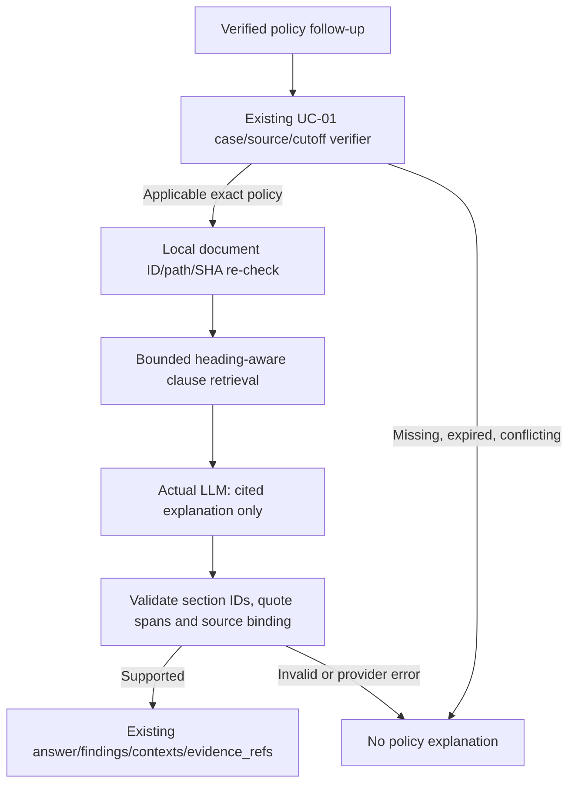

# UC-01 — Backorder Investigation · Implementation Detail

**Approval gate:** only a reviewed design revision merged to `main` is an implementation contract (a docs PR is a proposal) · **Design baseline:** RetailIQ `main@69c4bf4`, Fiction `fiction-retail-unified-v1.0.0` · **Scope:** one read-only end-to-end vertical slice.

**References:** [Basic Design](../DESIGN.md) · [Fiction runtime](../FICTION_RUNTIME.md) · [Data/API semantics](../DATA_API.md) · [Review 02 / context #22](https://github.com/hungtvb/retailIQ/issues/22) · [Review 03 / orchestration #23](https://github.com/hungtvb/retailIQ/issues/23) · [Review 08 / evidence #28](https://github.com/hungtvb/retailIQ/issues/28) · [Fiction source contract](https://github.com/hungtvb/fiction-retail/blob/main/docs/DATA_CONTRACT.md).

## 1. Problem, outcome and boundary

**User question:** “Investigate backorder case CASE-…: could another warehouse cover the requested quantity *at the case evidence cutoff*, which policy applied, and what decision is still needed?” Follow-ups may ask about a particular warehouse or the applicable policy without losing the case identity/cutoff.

**Expected outcome:** a source-addressable investigation with verified partial facts, alternative-warehouse observations, policy applicability and an explicit business disposition. **No shipment/stock/order mutation; no transfer execution.** An observation that passes stock/cutoff checks is **not** a transfer approval. Manager HITL belongs to [#29](https://github.com/hungtvb/retailIQ/issues/29) and must not be faked with a caller-supplied role.

**Milestone boundary:** M0 [#33](https://github.com/hungtvb/retailIQ/pull/33) and deterministic UC-01 T01 [#37](https://github.com/hungtvb/retailIQ/pull/37) have merged. T02 [#40](https://github.com/hungtvb/retailIQ/pull/40) wires an **explicit CASE-ID-only** LangGraph/`/ask` template, verified with **mock-provider + real SQLite fixture**. T03 [#44](https://github.com/hungtvb/retailIQ/pull/44) adds **committed-session case binding** for policy/alternative-warehouse follow-ups, with explicit source/cutoff re-verification; ambiguous positional warehouses require clarification. This is **not** the complete conversation-context capability in #22. The diagram remains a **full target flow**, not evidence that Fiction MCP/RAG/HITL/UI or **full** real-provider UC-01 E2E are accepted. The **bounded G1 real-provider T02** has since been verified separately ([run 41776582027](https://github.com/hungtvb/retailIQ/actions/runs/41776582027)).

## 2. Target execution flow

~~~mermaid
flowchart TD
    U[Operator: investigate CASE ID] --> API[Existing /ask or /ask/stream]
    API --> CX[Resolve explicit or committed-session case reference]
    CX --> PLAN[Validate bounded UC-01 capability plan]
    PLAN --> CASE[FictionStore: fulfillment_case + order]
    CASE --> IDENT{Identity and exactly one cutoff valid?}
    IDENT -->|No| STOP[Clarify / deny / fail closed]
    IDENT -->|Yes: bind case ID and cutoff| POLICY[Exact warehouse policy registry and source Markdown]
    IDENT -->|Verified case facts| FACT[Assess case-scoped snapshots, freshness, route and qty]
    POLICY --> JOINT[Verify policy, source versions and business claim]
    FACT --> JOINT
    JOINT --> OUT{Evidence-backed disposition}
    OUT -->|Eligible candidate + policy| REVIEW[Proposal requires manager review; no mutation]
    OUT -->|Verified exclusions only| NEG[Scoped negative finding, no transfer]
    OUT -->|Missing / conflicting evidence| PARTIAL[Verified partial facts + explicit gaps]
    REVIEW --> ANSWER[Authoritative AnswerResult + evidence refs]
    NEG --> ANSWER
    PARTIAL --> ANSWER
    ANSWER --> UI[Chat + actual observed execution events]
~~~

**Dependency invariant (B1):** the policy task **cannot run** from the initial plan alone. It requires a validated `case_id`, order-item/product scope, and exactly one `evidence_cutoff_reached` obtained from `FictionStore.fulfillment_case(case_id)`. Persist that cutoff as a typed output binding in the fixed UC-01 DAG. A model-supplied/current-date cutoff, policy ID or unverified prior chat text must not bypass the gate. Case facts and policy may join for verification **only after** both are bound to the same source release and cutoff.

**Control rule:** `resolve → plan once → validate → execute bounded reads → verify → assemble → finish`. The LLM may interpret phrasing/propose registered capabilities, but may not write unrestricted SQL, choose policy validity, alter case IDs, decide authorization or certify evidence. Use a fixed dependency DAG; no adaptive supervisor for UC-01 without a tested need.

**Request lifecycle:** one execution per request, committed same-session evidence only (#22); only verified results/evidence are stored. `/ask/stream` emits actual execution events plus **one authoritative final `result`**. Do not stream unverified factual draft text; graph edges reflect observed calls/returns, not hypothetical agents (#21/#30). Reject mismatched scope before policy/RAG work or business conclusions.

## 3. Source-to-code mapping — reuse first

| Responsibility | Existing source / owner | Necessary addition (not yet implemented) |
|---|---|---|
| Chat request/session | `retailiq/api/http.py`, `retailiq/infrastructure/sessions.py` | Route UC-01 request through current endpoints; persist only committed, case-linked evidence (#22) |
| Capability planning/execution | `retailiq/orchestration/week1_graph.py` | Registered, validated fixed UC-01 task plan, bounded calls and trace (#23); no new graph engine |
| Case, order, snapshot, eligibility SQL | `retailiq/domain/fiction.py` `FictionStore.open()` / `fulfillment_case()` / `order()` | **Reuse as-is first**; add only targeted read-only domain operation if a tested missing fact requires it |
| Release/access boundary | `retailiq/infrastructure/sqlite.py`, `data/fiction/manifest.json` | Explicit local Fiction DB; release hash/integrity/WAL gate; no `EL-###`/VND fallback |
| Effective policy evidence | Fiction `fulfillment_policies`, `knowledge_documents` and `knowledge/policies/FR-WH-2026-10-04.md` | **Deterministic exact policy lookup by verified case cutoff** + registry/document hash, source-version and effective-interval checks; policy RAG only explains verified text (#27), never selects binding applicability |
| Business verification | Existing case exclusions + Review 08 [#28](https://github.com/hungtvb/retailIQ/issues/28) | Shared source/identity/time/policy gate and qualified final disposition; no second verifier agent |
| UI / tracing | `retailiq/observability.py`, `frontend/src/main.tsx`, `frontend/src/graph.ts` | Display actual evidence/limitations and observed execution, not synthetic approvals (#30) |

The Fiction release stores **100 selected investigations**, not a full inventory ledger. `inventory_snapshots_v2` / `operational_events` are case-scoped; base `inventory` has **no stock observation timestamp** and cannot replace case evidence. The release has **zero actual received-after-cutoff snapshots**; that negative path requires a controlled adversarial fixture, not a claimed real-release example.

## 4. Input/output and deterministic acceptance contract

**Input (proposed, versioned at integration):** `request_id`, `session_id`, user question, explicit/inherited `case_id`, optional `warehouse_id` and requested action `investigate`. Validate `CASE-<UUID>`, canonical `order_id`/`order_item_id`/`product_id`, requested quantity and scoped warehouse. Resolve inherited references only from **committed same-session evidence**, not an LLM assertion or a refreshed ranking (#22). Principal/role, when #29 lands, come from the authenticated backend, **never** request/LLM payload.

**Trusted business reads:** `fulfillment_case(case_id)` yields `case`, `cutoff`, `snapshots`, `warehouse_eligibility`, `evidence_candidates`, `candidate_gap_reasons` plus `source` (release/hash), `scope`, `record_refs`, `temporal` and `limitations`. `order(order_id)` must match the case's order item/product; mismatch blocks the joined claim. **No generic LLM-generated SQL**.

**Case-evidence gate (deterministic):**
1. Verify the case/order/line/product/quantity relation using `fulfillment_case(case_id)` and `order(order_id)`; the selected `order_item_id` must belong to that order and product. Exactly one valid `evidence_cutoff_reached` exists; preserve its ISO timestamp (with offset) across follow-ups.
2. Only case-scoped snapshots for the same `product_id` are eligible; both `observed_at` **and** `received_at` must be ≤ cutoff, `received_at >= observed_at`, observation age ≤24 h. Inventory base table has no observation timestamp and **cannot** replace missing case evidence.
3. Select the latest available-at-cutoff observation **per warehouse**; a newer insufficient snapshot supersedes an older favorable one. Exclude assigned warehouse, unknown/denied route and `on_hand - reserved < request_qty`. Preserve `snapshot_id`, `warehouse_id`, timestamps and rejection reasons.
4. Distinguish **recorded alternatives with verified exclusions**, **no case snapshot**, and **unknown/incomplete alternative coverage**. `NO_VERIFIED_ALTERNATIVE_WAREHOUSE_CANDIDATE` describes only the **recorded, evaluated scope**; it never proves there is no stock anywhere. `NO_CASE_SNAPSHOT` is not zero on-hand stock.

**Exact policy lookup and provenance (B2):**

1. **Input dependency:** accept only the validated `case_id` and `cutoff` from step 1. Use the pinned Fiction release `fiction-retail-unified-v1.0.0` and select its **warehouse transfer** policy, not returns/pricing policy and not a semantic-search guess.
2. **Registry binding:** locate exactly one `fulfillment_policies.policy_id = FR-WH-2026-10-04`; join `knowledge_documents` on exact `policy_id` with `kind='business_policy'`. Require a unique `document_id`, `relative_path`, SHA-256 and the expected `requires_manager_approval` flag. The registry **does not contain validity dates**; do not pretend it does.
3. **Document integrity:** read the *local release's* `knowledge/<relative_path>` (expected `knowledge/policies/FR-WH-2026-10-04.md`), reject traversal/missing files, hash original Markdown bytes against `knowledge_documents.sha256`, and ensure the documents/registry/manifest belong to the **same pinned release**. No GitHub network dependency at runtime; reject unverified or mismatched source versions.
4. **Validity authority:** use the **release-locked, reviewed policy interval mapping** from Fiction's [Data Contract](https://github.com/hungtvb/fiction-retail/blob/main/docs/DATA_CONTRACT.md): `FR-WH-2026-10-04 → [2026-10-04, 2026-11-03)` in `Asia/Ho_Chi_Minh` (the policy Markdown displays 4 Oct–2 Nov inclusive). Implement as the smallest trusted config/typed mapping (or reuse an existing one), **not** filename-derived or LLM-extracted dates. Cross-check ID and effective statement against the verified document; an ambiguity/mismatch fails closed. Compare **timezone-normalized case cutoff** against that half-open interval, **not** `dataset_business_as_of=2026-11-03`.
5. **Decision rule:** missing/expired policy, hash mismatch, incompatible release, two overlapping authoritative policies without precedence, or inconsistent approval requirements block **transfer recommendation**. A verified policy conflict yields `NEEDS_REVIEW` for **evidence adjudication**, not an approval-ready transfer proposal. Surface exact reason codes and bounded policy evidence refs (e.g. `fulfillment_policies/FR-WH-2026-10-04`, `knowledge_documents/<document_id>`); RAG can supply a cited explanation **only after** applicability has been established deterministically.

**Policy implementation note:** do not add validity columns to Fiction SQLite, fetch the upstream repo at runtime, create a new policy database, or use embedding similarity to establish policy authority. If local source documents/registry are not yet imported (#27), the policy gate stays **unverified**; no policy-backed decision is marked PASS.

**Proposed final answer envelope:** keep existing `AnswerResult` fields (`answer`, `records`, `contexts`, `request_id`); add only the integration fields agreed in #28/#30: `disposition` (`SUPPORTED | NEEDS_REVIEW | INSUFFICIENT_EVIDENCE`), bounded `findings` with supporting `evidence_refs`, `limitations`, and actual trace/`source` metadata. Do not create a second answer schema.

**Status semantics (B3):** keep three orthogonal concepts: **execution** (completed / failed / denied), **evidence fitness for each finding** (`USABLE | QUALIFIED | BLOCKED`, #28), and **business conclusion disposition** (`SUPPORTED | NEEDS_REVIEW | INSUFFICIENT_EVIDENCE`, #30). Manager approval state is separate and is never inferred from `disposition`.

| Verified situation and scope | Finding / requested decision | Business disposition | Next action |
|---|---|---|---|
| At least one case-scoped alternative candidate passes snapshot/route/quantity and applicable policy is verified | Candidate and eligibility evidence supported; **proposed transfer is not approved** | `NEEDS_REVIEW` for proposed transfer | Authorized Manager review only (#29); no operational mutation |
| All **recorded** alternatives evaluated, with identifiable exclusion reasons and enough evidence for the **narrow question** “any verified candidate in this case?” | **Supported negative finding**: no eligible candidate among evaluated case observations. Never claim all company warehouses lack stock | `SUPPORTED` for scoped *negative finding*; **not** an executable transfer verdict | Report rejected warehouse/reasons and coverage limit; investigate unobserved options separately |
| No case snapshot, stale/late/unknown alternative evidence, policy missing/expired/mismatch, or insufficient coverage for **transfer feasibility** | Supported order/case facts may be shown; actionable transfer feasibility **not established** | `INSUFFICIENT_EVIDENCE` for proposed transfer | Request evidence/policy verification; do not treat missing as zero stock |
| Two authoritative policy documents overlap/conflict without trustworthy precedence | Conflict itself is supported; which policy authorizes a proposal is **unresolved** | `NEEDS_REVIEW` for **policy reconciliation**, explicitly **not** a manager-transfer approval request | Resolve authority; no proposal or mutation |
| SQL/tool/LLM timeout or exception, invalid case identity or forbidden plan | No trustworthy final business result | Execution `FAILED` / `DENIED` (or clarification); **no fabricated business disposition** | Safe error/clarification; do not persist unverified facts |

**Disambiguation rule:** A narrow **negative finding** may be `SUPPORTED` when the recorded alternatives are fully evaluated. That does **not** imply enough evidence to conclude real-world feasibility. If the user's question is broadly “Can any warehouse fulfill?” and coverage is incomplete, the **decision** remains `INSUFFICIENT_EVIDENCE`, even when “no candidate found in evaluated records” is a supported partial fact. Keep the claim's scope and `record_refs` visible.

## 5. Acceptance scenarios — exact golden oracle + adversarial fixtures (B4)

**Published-release SQL golden cases** (independently checked against the local, pinned Fiction SQLite; these **do not** prove Agent/RAG E2E). Each test must assert input `case_id`, exact `cutoff`, canonical order/item/product scope, selected/rejected `snapshot_id`, actual `warehouse_id` and quantity, source/version refs, reason codes and **business disposition** after policy integration.

| Test / user request | Independent expected result at case cutoff | Expected answer contract |
|---|---|---|
| **UC01-G1: eligible alternative**, `CASE-06181249-280d-59b3-b00b-b3de7877eb59` | Cutoff `2026-10-21T11:00:00Z`; requested **1**; alternative warehouse `bd0b4a2e-3f75-46a1-bf8a-5a82594d70a4`; **latest** `SNAP-850016da-7ba6-594a-8532-ca23e4085e89` (`on_hand=6, reserved=1, available=5`), observed `2026-10-21T10:00:00Z`, received `2026-10-21T10:05:00Z`. Warehouse policy effective at cutoff | Candidate evidence **SUPPORTED**; disposition `NEEDS_REVIEW` **for proposed transfer**, no approval or stock write; refs include case, cutoff event, candidate snapshot, warehouse route and exact policy document |
| **UC01-G2: recorded alternative insufficient**, `CASE-15332a00-70bb-59b0-9aa4-a44a7b1a37a9` | Cutoff `2026-10-24T11:00:00Z`; requested **1**; alternative `2f1e95b4-aa81-4b55-926d-70531f59528d`; `SNAP-5ff78bcc-d9e5-5b28-9580-ca4626e316de` has **available=0** and `INSUFFICIENT_AVAILABLE`. No verified candidate from evaluated recorded alternatives | `SUPPORTED` **scoped negative finding** only; no “stock unavailable everywhere” and no transfer proposal. If asked about **all warehouses**, report limited coverage rather than global impossibility |
| **UC01-G3: no case observations**, `CASE-103510dd-95fb-5a4d-9f26-f508b3a73df3` | Cutoff `2026-10-22T11:00:00Z`; requested **1**; **0 case snapshots**; alternative route `90d6c40d-10d6-432b-99fe-bd1448f1aa57` has `ELIGIBILITY_ASSUMED_STOCK_UNKNOWN`. Snapshot limitation `NO_CASE_SNAPSHOT` | Show only supported order/case/route facts; `INSUFFICIENT_EVIDENCE` **for fulfillment/transfer conclusion**, never assert zero stock or negative warehouse inventory |

**Policy oracle (same release):** `FR-WH-2026-10-04`, `knowledge_documents.document_id = DOC-de8b393e-45d7-53f3-b1d4-9366a5d0c134`, path `knowledge/policies/FR-WH-2026-10-04.md`, expected SHA-256 `f3ff7463e67e034360fd87b35c1c71286445be0de1431009591821489bd4d9c8`, effective **[2026-10-04, 2026-11-03)** in Asia/Ho_Chi_Minh, manager approval required. SQL registry binding and source-doc byte hash must be separately verified **at runtime**; listed expected metadata is **not** proof docs were imported into RetailIQ yet.

**Fixture-only negatives** (not claims about the actual 100-case release): `UC01-F1` late-received/observed-after-cutoff, `UC01-F2` newer insufficient snapshot supersedes older sufficient, `UC01-F3` expired/no/overlapping/conflicting policy and wrong/missing doc SHA, `UC01-F4` case/order/item mismatch, `UC01-F5` cross-session wrong case/cutoff or malformed model plan, `UC01-F6` timeout/SSE disconnect. Assert exact exclusions (`RECEIVED_AFTER_CUTOFF`, `OBSERVED_AFTER_CUTOFF`, `SUPERSEDED_BY_NEWER_OBSERVATION`, etc.), stop reasons, source refs and **no unauthorized mutation**. The published release has **zero received-after-cutoff observations and no case whose cutoff is outside the warehouse policy window**; these branches require fixtures.

**Provider/Agent E2E gate — scoped G1 PASS; wider scenarios PENDING:** [live run 41776582027](https://github.com/hungtvb/retailIQ/actions/runs/41776582027) on main `ece87044` completed with an actual model on pinned Fiction release, no router fallback, exact SQL/policy oracle, case/cutoff/warehouse/snapshot and 6 verified refs. Extend to additional golden/adversarial cases when warranted and inspect LangGraph execution/trace: requested `case_id`, *actual tool invocation IDs, inputs/outputs*, cutoff, policy lookup, verified candidate IDs, final disposition/findings/limitations, session scope and usage. Compare against the independent SQL/policy oracle; a fluent answer without matching tool arguments and evidence is a FAIL. Record commit, release hash, model/provider, mode, inputs, expected/observed outputs and trace IDs. **M0-only** `python -m scripts.verify_fiction_runtime --db data/fiction/fiction_retail.sqlite --manifest data/fiction/manifest.json` proves none of this.

## 6. Implementation order and stop conditions

1. **M1 deterministic contract gate:** reuse `FictionStore`; validate case/line/cutoff, exact release-locked policy registry/document applicability, business disposition and G1–G3 + critical fixture negatives with independent SQL oracle. This is callable directly **without** claiming Agent/LLM/UI works.
2. **First wired Agent gate (M2):** fixed registered capability DAG (#23) consumes M1, minimal same-session reference handling (#22), one actual `/ask` or `/ask/stream` path and real-provider golden run when configured. Real LLM usage must be identified explicitly, not inferred from mocks. Policy decision uses **exact deterministic lookup** even if #27's explanatory RAG is still pending.
3. **Full UC-01 integration / acceptance (M2–M5):** source-policy RAG explanations (#27), actual MCP invocation only where #26 requires it, truthful evidence/UI/SSE (#21/#30), and authenticated manager review (#29) before **any** claim of authorized HITL. App-facing session/ownership validation must follow #29; a local unauthenticated prototype is not security acceptance. No stock/order/transfer mutation.

**Prioritization remains independent:** drafting UC-01 does not decide whether Backorder or Refund Reconciliation is implemented first. Reuse shared capability issues and create new task issues only for independently verifiable gaps; do not block all M1 correctness work on complete RAG/MCP/HITL.

**Implementation gate:** review/merge this design into `main` **before** a feature code PR; that code PR must link this path + approved design commit and state deviations. Significant changes to capability, temporal, policy or trust contracts require design review first. Small clarifications may travel in the code PR only when the approved behavior is unchanged. No separate UC-01 microservice, agent framework, event bus, extra source database or unrequested action endpoints.

## 7. T04 — Inventory/Order MCP integration plan

**Owner:** [#26](https://github.com/hungtvb/retailIQ/issues/26); **UC parent:** [#34](https://github.com/hungtvb/retailIQ/issues/34). **Approved and implemented:** design [PR #45](https://github.com/hungtvb/retailIQ/pull/45), code [PR #46](https://github.com/hungtvb/retailIQ/pull/46), T04 technical acceptance [#26](https://github.com/hungtvb/retailIQ/issues/26). T01 historical cutoff/policy and T03 committed same-session binding remain authoritative. This is one bounded MCP integration slice, not a general Fiction migration.

### Scope and precise entry paths

- **Shared tool surface:** existing FastMCP **stdio** server + LangChain MCP adapter; `inventory_lookup(product: str, warehouse_id: str | None = None)` accepts **one** canonical UUID or complete `FR-` SKU, resolves it with verified `FictionStore.inventory()`. `order_lookup(order_id: str)` accepts a canonical Fiction order UUID and uses `FictionStore.order()`. Both are **read-only**; no model SQL, extra server, new database or duplicated business SQL.
- **Inventory chat path:** only in `RETAILIQ_MODE=full`, when the user supplies **exactly one** valid full `FR-` SKU and clearly requests inventory, the existing LangGraph router takes a deterministic **Fiction-inventory MCP** branch before the legacy stock route/LLM can reinterpret identity. Validate the single SKU and optional explicit warehouse UUID before invocation; multiple/ambiguous or time-qualified requests clarify/deny. Otherwise retain existing legacy stock routing; **no broad intent cutover**. Output labels stock as **undated**, with source/scope/record_refs/limitations and no current/historical freshness claim.
- **UC-01 order-detail chat path:** after a successful case investigation, a bounded same-session follow-up such as “Đơn hàng này gồm những sản phẩm nào?” resolves solely via T03's **latest committed assistant `case_binding`**. Route as `backorder` to the existing `backorder_agent`; rerun `investigate_backorder(case_id)` to verify original case/source SHA/cutoff and derive the **actual order_id and order_item_id/product_id** from trusted case/order facts, then call **real** MCP `order_lookup(order_id)` and validate matching order, referenced line, product, source release and checksum. The order detail must not change historical case cutoff or approve a transfer. If context is missing/corrupt/cross-session, source differs or line/product mismatch, **clarify/fail closed before a business answer**. Do not use LLM-extracted order IDs or free-text assistant output as authority.
- **Temporal split for case-linked order details:** the MCP order's `order_status` and shipment fields are **release-recorded facts**, not proof of their state **at the historical case cutoff**. Only original order/line identity and quantities may be joined to the historical case after validation; any later shipment/status information must be explicitly labeled as a **separate release-as-of view**, never fed back into the cutoff-based eligibility/policy disposition. A request for “shipment status at cutoff” without authoritative status history must return `INSUFFICIENT_EVIDENCE`, not present the later value as historical.
- **Committed follow-up invariant:** if the order-detail response is persisted as a verified UC-01 turn, extend the existing **allowlisted** `capability_plan`/`_committable_case_binding` check just enough to recognize the exact `fiction.backorder.investigate` + `mcp.order_lookup` path and retain the original case_id/cutoff/source. Do **not** loosen the allowlist to arbitrary MCP names or accept unverified `ToolMessage`/checkpoint content. Non-case topic switches must not inherit case binding.
- **No redundant MCP:** an ordinary UC-01 case investigation still uses the trusted local case and exact policy path; **do not** reread base inventory through MCP to 'corroborate' case-scoped snapshots. Only the two explicit paths above invoke MCP. `FictionStore` remains the sole business source for direct SQL and MCP; no independent-source corroboration is claimed.
- **Legacy boundary:** the same server cannot silently serve old `EL-###`/`ORD-0001` data when in Fiction mode. After migration, existing legacy MCP opt-in (`RETAILIQ_INVENTORY_USE_MCP`/`RETAILIQ_WORKFLOW_USE_MCP`) must be explicitly rejected as unsupported or deliberately gated without mixing datasets; existing **direct SQL** legacy flows stay intact. No quiet direct fallback on MCP error.

~~~mermaid
flowchart TD
    Q[API / ask: full mode] --> R{Bounded trusted route}
    R -->|One explicit FR-SKU stock request| IM[Inventory MCP adapter]
    R -->|Committed UC-01 order-detail follow-up| C[Reverify case, cutoff and order identity]
    C --> OM[Order MCP adapter]
    R -->|Other UC-01 / legacy question| D[Existing trusted direct path]
    IM --> M[Existing FastMCP stdio server]
    OM --> M
    M --> F[Manifest-verified FictionStore]
    F --> V[Validate MCP execution, source and scope]
    V --> A[Verified reply, events and session evidence]
~~~

### Source, validation and failure contracts

- Return the existing Fiction envelope `data`, `source.id/version/sha256`, `scope`, `record_refs`, `temporal`, `limitations`; validate the exact request ID, UUID/SKU → canonical product_id, warehouse/order filter, expected pinned release hash and permitted record-ref prefixes **after** decoding. Use bounded response schemas and no PII. The adapter must validate identities and source; it may not replace shared business validations with its own SQL.
- **Historical inventory request:** `as_of` is intentionally **not a tool parameter** in T04. If the natural-language question asks for stock at a past/future time, stop **before** MCP invocation with `UNSUPPORTED_TEMPORAL_SCOPE`/clarification; do not silently drop time scope. `inventory.last_restocked_date` is **not** an observation time. Known product/warehouse with no inventory row → `NO_INVENTORY_RECORDS` (unknown quantity, not zero); unknown product → `PRODUCT_NOT_FOUND`; for an explicit, well-formed warehouse UUID verify that warehouse actually exists in Fiction's warehouse master before classifying absent stock, otherwise return `WAREHOUSE_NOT_FOUND`. Malformed product/warehouse identifiers are input validation errors. Extend this **shared** `FictionStore.inventory()` distinction only if the actual release schema supports it. Case-scoped snapshots belong only to `fulfillment_case` and never substitute for undated base inventory.
- **Order domain validation to add in the code PR:** `FictionStore.order()` currently returns unvalidated selected rows. Before exposing them as validated, check requested order identity; every returned order line belongs to that order, has canonical item/product IDs, existing product reference, positive integer quantity, finite nonnegative monetary unit price and integer discount percentage within [0,100]. Check shipment/order linkage and canonical shipment/warehouse IDs for any returned shipment. Refuse inconsistent data with `FictionDataError`; add independent corrupt-line, wrong-product/order and bad-shipment fixtures. Bound total order lines/shipments (fail rather than silently truncate records) and reuse the **same** validation for direct and MCP callers.
- **Error handling:** prefer `MultiServerMCPClient(handle_tool_errors=False)` in a verified compatible adapter version so MCP `isError=True` raises, or explicitly reject a returned `ToolMessage.status='error'` **before any** `artifact`/`content` decoding. Reject ambiguous multi-block output, missing schema, malformed/source-mismatched data and transport/protocol errors; never treat an error-shaped dict as a successful order/stock result. No raw exception details, credentials or PII in user/SSE output.
- **Orthogonal outcomes:** missing product/order and no stock rows are **structured business absence** with limitations; unknown freshness/unsupported time is **insufficient evidence**; invalid input is **clarification/422**; MCP transport/decode/source-integrity/timeout errors are **execution failure/503** without a fabricated business disposition. Actual `mcp.tool.started/completed/failed` spans cover invocation plus validation; `completed` requires a valid result, not merely a handshake or returned error content. Request/session correlation stays in the existing observability/SSE system.
- **Runtime and SDK choice:** require the pinned Fiction DB + manifest and reject missing/wrong releases; never use the legacy SQLite default. Existing `langchain-mcp-adapters` was **archived on 2026-09-17** and LangChain now recommends `langchain.mcp` / `MCPAdapter`. **For T04, retain the already-integrated legacy adapter and MCP SDK v1 (`mcp>=1.28,<2`) only as a bounded compatibility decision**, because switching client/server stacks together would alter the tested transport contract. Before code, record the *resolved installed versions* and verify actual stdio/error behavior; if unsupported or insecure, **stop and review migration rather than silently expand scope**. Record subprocess launches and discovery/call/release-verification/end-to-end latency; apply a bounded timeout covering launch/discovery/invoke. Do not add pooling/caching before measuring. Plan a separate migration to the actively supported API after this slice; no production-readiness claim on archived dependencies.
- **Code locality (when approved):** `retailiq/mcp_server.py`, `retailiq/mcp_adapter.py`, a minimal `retailiq/domain/fiction.py::order()` invariant check, narrow routing in `retailiq/orchestration/week1_graph.py`, existing committed case-binding allowlist in `retailiq/infrastructure/sessions.py`, targeted tests and `scripts/smoke_mcp_stdio.py`. Update `docs/DATA_API.md` and `docs/FICTION_RUNTIME.md` **with actual implementation**; no new framework, agent or duplicate design document.

### Acceptance and explicit test modes

1. **Real MCP stdio:** start subprocess, complete handshake, discover **both named tools**, invoke each using the real LangChain adapter, verify requests and structured outputs. Replace `EL-003`/`ORD-0001` in the existing smoke with actual Fiction fixture IDs. Record actual subprocess count, handshake/discovery/call/verification durations, timeout/error paths. No mocked tool as transport proof.
2. **Independent read-only SQL oracle:** compare canonical SKU/product resolution, exact warehouse stock arithmetic, order + line + shipment IDs/quantities, source refs and manifest SHA, and prove no customer PII or DB changes. Comparing MCP to `FictionStore` alone is **same-source consistency**, not an independent SQL oracle.
3. **Negative gates:** ambiguous/multiple IDs, missing/unknown product, order or warehouse, no inventory rows, requested historical stock time, corrupt/extra source/identity, invalid numeric line/shipment data, MCP `isError`, malformed content, subprocess unavailable/timeout and cross-session/stale case binding → correct absence/clarification/failure; **no invented numbers or transfer approval**.
4. **Compiled LangGraph + FastAPI/SSE:** one explicit FR-SKU stock turn and one case-linked order-detail follow-up must **actually invoke MCP**, emit persisted request/session-correlated `mcp.tool.*` spans and preserve case release/cutoff on the latter. A recorded shipment/status update **after case cutoff** must never appear as a status at cutoff. Existing explicit-case T01–T03 and unrelated legacy direct-SQL scenarios must not regress.
5. **Evidence by mode:** (a) deterministic mini Fiction fixture + real stdio, (b) pinned real Fiction SQLite + independent SQL, (c) separately configured provider-backed LLM CI. For each, record commit, release/DB SHA, commands, exact tool arguments/results, oracle expected/observed, PASS/FAIL, latency and limitations. Do not label fixture-only or mock-provider runs as live Fiction/LLM E2E. Keep generated evidence outside Git. The T04 technical gate is now verified and [#26](https://github.com/hungtvb/retailIQ/issues/26) closed; **full UC-01 live-provider/browser/RAG/HITL acceptance remains OPEN**.

**Official compatibility references:** [LangChain MCP migration announcement](https://www.langchain.com/blog/mcp-in-langchain-stateless-protocol-elicitation-and-more); [LangChain current MCP tools/error semantics](https://docs.langchain.com/oss/python/langchain/mcp#tools); [Legacy adapter error handling (archived)](https://github.com/langchain-ai/langchain-mcp-adapters/blob/main/langchain_mcp_adapters/client.py); [MCP v2 migration/v1 maintenance](https://github.com/modelcontextprotocol/python-sdk/blob/main/docs/migration.md).

## 8. T02 — Live-provider golden-case acceptance (approved design)

**Owner:** Orchestration [#23](https://github.com/hungtvb/retailIQ/issues/23); UC-01 parent [#34](https://github.com/hungtvb/retailIQ/issues/34). **Approved:** [design PR #48](https://github.com/hungtvb/retailIQ/pull/48), main commit `5a083bbf045e945edf7016b26468e133b6153c53`. **G1 acceptance verified on 2026-11-04**: [live G1 run 41776582027](https://github.com/hungtvb/retailIQ/actions/runs/41776582027) on merged `main@ece87044`, downloaded JSON evidence `retailiq-live-llm-evidence`, actual LLM route + read-only SQL, independent policy/SQL oracle PASS. This does **not** establish T05–T08. §5 already defines the authoritative G1/G2/G3 source IDs, cutoff, policy hash and expected dispositions; §6 defines the first bounded Agent gate. **Do not duplicate or change those business contracts.**

**Initial gap resolved for bounded G1:** Existing .github/workflows/live-llm.yml supports manually triggered suite=uc01 on main with protected llm-evaluation credentials. The existing test_uc01_t02_live_provider_route_with_verified_sql_fixture invokes a **real provider** but uses a small, verified Fiction fixture. The T04 release gate separately proved real SQLite/MCP without an LLM. The later [G1 live provider run](https://github.com/hungtvb/retailIQ/actions/runs/41776582027) verifies this missing boundary for one case; all other capabilities retain their own gates.

**Exact execution path:** /ask (explicit §5 G1 CASE-ID) → existing LangGraph real ChatOpenAI structured router → backorder_agent → actual read-only investigate_backorder/FictionStore plus exact policy file verifier → verified final. The model may classify **only**; it cannot supply business facts, SQL, entity IDs, a policy decision or manager approval.

**Planned implementation (after design approval):**
1. **CI/source:** Extend the existing uc01 suite of .github/workflows/live-llm.yml; do not create another workflow. Fetch published 209,063,936-byte Fiction Git LFS SQLite with pinned manifest SHA-256 015b0a84d8d93870c6facd359347f4c039bc7fc570000890c581010d0451af42, plus exact warehouse policy Markdown. Reuse the release-check approach in scripts/verify_t04_real_release.py. Reject LFS pointer/wrong SHA/missing policy. No RAG indexing, embeddings, cloud runtime or new service is needed for this slice.
2. **Test:** Add one real-release G1 scenario through actual /ask + compiled LangGraph + provider, using the existing fixture-backed test as a separate regression. Observation-only wrapping may capture actual investigate_backorder arguments (never stub its result). Compare the **actual** case/order/line/product identity, case cutoff, warehouse, snapshot, quantity, observed/received time, policy ID/document SHA, evidence refs and disposition against independent **read-only raw SQLite + policy-file hash oracle** from §5. Verify database SHA unchanged.
3. **Live route gate:** Require observed real model call, intent=backorder, active_agent=backorder_agent, route_fallback=false, disposition=NEEDS_REVIEW, approval_status=NOT_REQUESTED. Capture actual tool.sql started/completed and request-correlated final evidence; **do not invent MCP calls** for a normal direct-SQL case. Any provider exception/disagreement/fallback, invalid source/time/identity, corrupt policy, unverifiable evidence, transport failure or timeout **FAILS** acceptance even when deterministic fallback answered.
4. **Modes/report:** PR CI can run deterministic/offline oracle and injected negatives **without provider secrets**. The paid suite stays **manual workflow_dispatch on main only after reviewed code PR merge**; upload non-secret model ID, code/release SHA, scenario ID, expected/observed IDs and disposition, request/trace ID, latency, test mode and PASS/FAIL as an Actions artifact. Only check T02 after the completed live run and artifact are reviewed. If dispatch access or provider support is unavailable, record BLOCKED, not PASS.

**Boundaries:** Preserve T01 authority and T03 session bindings; no dynamic planner, extra agent, Text-to-SQL, new verifier, claim of current inventory, RAG, browser, manager HITL, full UC-01 T08, tokens/cost or ROI. Keep provider-specific structured-output incompatibility visible rather than silently switching methods.

**Technical references:** [LangChain ChatOpenAI structured output](https://reference.langchain.com/python/langchain-openai/chat_models/base/ChatOpenAI/with_structured_output); [GitHub manual workflow dispatch](https://docs.github.com/en/actions/how-tos/manage-workflow-runs/manually-run-a-workflow?tool=webui).

## 9. T05 — Source-verified policy explanation RAG (APPROVED DESIGN; ACCEPTANCE TRACKED IN #34)

**Gate:** design reviewed and merged in [PR #56](https://github.com/hungtvb/retailIQ/pull/56), **approved main `a7470fdecac01e5b7635430beab8bbf2086cefb0`**. Owner [RAG #27](https://github.com/hungtvb/retailIQ/issues/27), parent [UC-01 #34](https://github.com/hungtvb/retailIQ/issues/34). T05 implementation and verification are tracked in [PR #57](https://github.com/hungtvb/retailIQ/pull/57); **scoped provider-backed T05 ACCEPTED** on merged `main@ff981e193256d9bf6fd46e11cb6e02ed32b27c26` after inspecting [live run 41839652957](https://github.com/hungtvb/retailIQ/actions/runs/41839652957); [R1 #51](https://github.com/hungtvb/retailIQ/issues/51) accepted earlier G1, not this feature. The model's role is restricted to **selecting verbatim policy evidence**, with answer claims rendered from approved section-level text to prevent unsupported free-form policy authority. Because the claim templates are reviewed against **one immutable policy revision**, T05 pins the expected original-byte SHA (`f3ff7463e67e034360fd87b35c1c71286445be0de1431009591821489bd4d9c8`) in addition to T01's registry hash: a later policy document revision must undergo a new content/claim review, even if the registry and document hashes agree.

**Business outcome:** staff asks “Vì sao cần Manager phê duyệt?” or “Chính sách yêu cầu gì khi snapshot quá 24 giờ?” after a **verified same-session case**. Answer with the applicable *warehouse transfer policy's specific clause*, exact source/cutoff and supporting passage, not just its policy ID. T05 must never let embeddings, document text, a model or chat history select policy applicability or approve a transfer.

### Flow and decision

**Selected retrieval:** **2-step RAG with exact-document, section-aware retrieval**, not a new global vector search. T01's `domain/backorder.py::_effective_warehouse_policy` already verifies a unique `FR-WH-2026-10-04`, document registry, original Markdown hash, `[2026-10-04, 2026-11-03)` cutoff and Manager-review rule. The source file is ~1.7 KB with five named clauses. A Chroma index for a single already-identified policy adds unnecessary rebuild/stale-index failure modes; the broad 5,003-source Chroma/vector/hybrid ingestion and evaluation remains **OPEN in #27**. If exact passage selection fails measured acceptance, review filtered Chroma retrieval rather than silently adding a second index.

### Implementation contract (one reviewed code PR, vertical slice)

1. **Entry and guard:** Only `uc01_followup_kind='policy'` after verified committed session binding and existing `backorder_agent` source/version/sha/cutoff checks. Original explicit CASE-ID G1, legacy routes, LangGraph state, node names, `Command` destinations, SQL/MCP calls and business disposition **unchanged**. Policy ID/cutoff/path from the user or LLM have no authority.
2. **Source:** Require `investigation['data']['policy']` to be non-null, `applicable_at_cutoff=true`, matching case release. Verify original bytes from `knowledge_root/<verified relative_path>` **again** immediately before retrieval, bounded file size, inside root, no symlink/traversal, with SHA against the already trusted document registry. Do **not** recalculate effective-date policy rules in RAG; T01 owns them. Missing/conflicting/expired policy => no detailed RAG explanation.
3. **Retrieval:** Reuse existing safe Markdown loader and add a minimal heading-aware clause selector under `retailiq/rag/` (e.g. `policy_explanation.py`, extend `rag/chunking.py` only if needed). Select from **only the verified policy document**: `Transfer eligibility`, `Inventory information`, `Review and approval`, `Exceptions`; keep section headings, bounded excerpts and stable refs `knowledge_documents/<document_id>` + section ID/quote. No generated `rag/chunks.jsonl`, legacy `EL-` corpus, broad corpus scan, new Chroma store, persistent cache or runtime GitHub read.
4. **Generation:** full-mode configured LLM receives bounded passages as **untrusted data**, explains only selected source text with exact quote spans/section citations. Reuse `rag/grounding.py` source-label machinery but do not mistake a syntactically valid `[S1]` for semantic proof. Enforce bounded structured output, exact source/section IDs, quote substring match and no model-authored approval, stock/current-time/cutoff or policy applicability. Fail invalid/unsupported claims closed; semantic support also needs scenario and provider-backed review.
5. **Output/failure:** inject a narrowly scoped optional explanation callable from existing `week1_graph.backorder_agent` into `fiction_handlers.backorder_update`; preserve existing `answer`, `findings`, `contexts`, `evidence_refs`, `limitations`, `source`, `disposition`, `approval_status`, schema and committed context. On retrieval/model/grounding failure return **qualified verified base facts only**, add `POLICY_EXPLANATION_UNVERIFIED`, no fabricated passage or approval. Instrument **actual** retrieval/model calls in existing observability; never emit fake tool events.

### Acceptance and evidence

| Mode / scenario | Required assertion |
|---|---|
| Offline + compiled LangGraph/FastAPI/SSE | G1 verified policy follow-up “why approval?” cites `Review and approval`; “24-hour snapshots?” cites `Inventory information`; EN/VN works. Original source SHA, cutoff, candidate/5 units, `NEEDS_REVIEW`, `NOT_REQUESTED`, binding, traces and no-write remain unchanged. |
| Negative / adversarial | Wrong returns/pricing policy, nonexistent/mutated source, symlink/traversal, wrong/expired cutoff, mismatched release/section ref, missing or cross-session context, injected instructions, unsupported quote/citation/approval, provider timeout => abstain/qualify, no transfer execution or false source claim. |
| Published Fiction release | Exact G1 case oracle from §5: policy `FR-WH-2026-10-04`, document `DOC-de8b393e-45d7-53f3-b1d4-9366a5d0c134`, bytes SHA `f3ff7463e67e034360fd87b35c1c71286445be0de1431009591821489bd4d9c8` and original section excerpt; no policy selected by ranking/model. |
| Provider-backed paid gate | A new **explicit opt-in `uc01_policy`** suite within the *existing* `live-llm.yml` after code merge on new main: actual retrieval + LLM calls, cited exact passages, negative unsupported-output case and recorded latency/tokens. Prior T02 G1 live run `41790444949` **does not** prove T05. |

**Stop/rollback:** If the policy explanation cannot add useful accurate clause-level information beyond T03's verified deterministic sentence, or grounded generation cannot pass scenarios, keep the existing safe answer and report T05 pending; no needless agent, indexing of 5,003 documents, policy authority rewrite or fabricated RAG PASS. Once implemented, update #27/#34, relevant docs and Capability Ledger by *execution evidence*, not by PR status.

**Technical references:** [LangChain retrieval and 2-step RAG](https://docs.langchain.com/oss/python/deepagents/retrieval); [Chroma query metadata filtering](https://docs.trychroma.com/docs/querying-collections/metadata-filtering) (future scoped vector comparison, not a T05 dependency).

## 10. T06 — Authenticated Manager HITL (PROPOSED; REVIEW BEFORE CODE)

**Gate and owner:** this is the **T06-specific implementation design**, not approval to code until this revision is reviewed and merged. It refines the already **approved architecture decision** in [Review 09 / #29](https://github.com/hungtvb/retailIQ/issues/29); parent [UC-01 #34](https://github.com/hungtvb/retailIQ/issues/34). Inspected baseline: `main@ff981e193256d9bf6fd46e11cb6e02ed32b27c26` (T05 accepted). The implementation Issue and PR must cite this section's **eventual approved merge SHA**, not this proposal branch.

**Business outcome:** an authenticated Analyst submits an *evidence-backed historical backorder candidate* for Manager review; an authenticated Manager accepts or rejects that **local proposal only**. The decision is attributable, one-time, versioned and visible to the submitting user. **Neither decision causes stock transfer, inventory reservation, order update nor shipment.** Preserve T01–T05 case identity, source release, evidence cutoff, policy validity and original `NEEDS_REVIEW` finding. A historical observation is not current operational inventory.

### Approach, boundaries and alternatives

**Chosen for design review:** minimal same-origin, local SQLite authentication and session ownership; a narrowly scoped immutable UC-01 proposal snapshot; and a small checkpointed LangGraph human-review step. Reuse existing FastAPI, chat SQLite and LangGraph SQLite checkpoint infrastructure; no new Agent, web service, event bus or authorization framework.

- **Rejected — reuse `workflow_demo.review_run(role='manager')` as authority:** request-body role is caller-controlled and the existing workflow is explicitly simulated. Keep that legacy demo labeled **simulation only** until separately retired; it must never approve a UC-01 proposal.
- **Rejected — reuse Analyst's chat thread as Manager's approval checkpoint:** it would give a Manager access to another user's conversation and risks reviving unrelated chat graph state. Use a distinct `uc01-review:<proposal_id>` checkpoint thread with a bounded proposal payload.
- **Rejected — external IAM / OAuth / dedicated approval service:** unjustified for local Fiction Retail with two roles. Revisit only if the business or deployment boundary changes.

**Scope:** only `analyst` and `manager` accounts, local operator CLI provisioning, host-only cookie login/logout, authenticated ownership and local proposal decisions, plus minimal Workspace login and review controls. No public signup, JWT, SSO, admin UI, per-warehouse permissions, production security certification or real Fiction writes. **Security is an application boundary, not a new graph agent.**

### Trust and data flow

~~~mermaid
flowchart TD
  Login[Login: server verifies Argon2id password] --> Auth[Trusted principal + owned auth session]
  Auth --> Chat[Analyst: owned chat and committed UC-01 G1 binding]
  Chat --> Verify[Re-run deterministic case / cutoff / source / policy gate]
  Verify -->|Not eligible or stale| Stop[Reject submission; verified answer unchanged]
  Verify -->|NEEDS_REVIEW with eligible candidate| P[(SQLite: immutable pending proposal + version)]
  P --> Interrupt[Separate LangGraph human-review interrupt + checkpoint]
  Interrupt --> Inbox[Manager: bounded proposal inbox, not Analyst chat]
  Inbox --> Gate[Authenticate Manager; CSRF; CAS version + recheck provenance]
  Gate -->|Denied / replay / changed source| Stop
  Gate -->|Approved / rejected| Decision[(SQLite: one-time local decision + reviewer)]
  Decision --> Resume[Command resume: real observed review completion]
  Resume --> Status[Owner sees decision status; no Fiction operational write]
~~~

**A. Authentication / authorization:** add a small backend security module and CLI (`scripts.manage_users`) backed by the existing application SQLite database, not Fiction. Operator prompts for password without echo; Argon2id via `pwdlib[argon2]` (pin/verify installed versions before code). Add `users` and `auth_sessions`: roles constrained to Analyst/Manager, disabled flag, random opaque token (store only SHA-256), expiry/revocation, and server-bound CSRF token. Use `HttpOnly`, host-only, `SameSite=Strict`, `Path=/`; set `Secure` for HTTPS and retain loopback-only restriction for local HTTP. Rotate session on login, expire and invalidate on disable/logout; generic credential errors and bounded per-identity/peer login attempts. **Never** log password, raw session token or CSRF token.

Routes: `POST /api/auth/login`, `GET /api/auth/me`, `POST /api/auth/logout`. Require full same-origin `Origin`/`Referer` verification for login and every state-changing cookie request, plus a server-validated CSRF header for authenticated mutations; do not rely solely on SameSite or naive double-submit cookies. The UI obtains an authenticated CSRF value from `/api/auth/me`, stores it in memory only. Use no credentialed wildcard CORS, user-supplied `role`, security-bypass environment flag, or raw cookies in graph state. Allow public static login assets and `/health`; require verified principal **before any data/model/tool work** on `/ask`, `/ask/stream`, sessions, history/memory/traces, workflow, ROI, logs and other business/diagnostic API routes. Establish principal in the API boundary; carry only `SecurityContext(user_id, role)` across the SSE worker, not a request-supplied identity.

**B. Conversation ownership:** add nullable `sessions.owner_user_id` with foreign-key linkage to `users`. All *new* conversations require authenticated ownership; scope list/get/history/add/delete/memory/trace/checkpoint by owner in SQL and verify before reading checkpoints or hydrating model context. Existing ownerless conversations remain **inaccessible** until explicit local disposal or separately reviewed migration; never silently assign them to whoever logs in first. Managers can inspect the **sanitized proposal record** but **not** another employee's messages, memory, raw trace or checkpoint. Existing `/api/logs` must not reveal cross-user session metadata; deny unscoped log access unless a reviewed role-specific disclosure policy exists.

**C. Proposal contract (backend-generated; no LLM authority):** `POST /api/uc01/proposals` accepts an owned `session_id` only, not a model-selected case, warehouse, cutoff, decision or role. Require the latest *committed* `last_committed_case_binding`, `disposition=NEEDS_REVIEW` and `approval_status=NOT_REQUESTED`. Re-run `domain/backorder.py::investigate_backorder` on the pinned trusted Fiction release: matching case/order line/product, original historical cutoff, exact applicable policy, approved warehouse route, snapshot and positive available quantity; **reject** policy-conflict-only `NEEDS_REVIEW` without a real candidate. Persist a bounded immutable canonical proposal (case ID, source ID/version/SHA, cutoff, policy ID/document SHA, order item/product, candidate warehouse/snapshot/requested/available, evidence refs and a canonical fingerprint) in existing app SQLite. Record owner, `proposal_id`, version 1, creation/expiry time, `PENDING` decision and graph resume status separately. Expiry is a **local review-window limit**, not a substitute for case-cutoff validity or current stock freshness. Never store free-form LLM claims as authorization evidence.

Manager-only `GET /api/uc01/proposals` and `GET /api/uc01/proposals/{id}` expose only review-needed, non-sensitive fields; a submitter can read only their own proposal status. `POST /api/uc01/proposals/{id}/decision` accepts `decision=approve|reject` and `expected_version`. Server validates actual Manager role, origin/CSRF, pending state, expiry, exact immutable fingerprint/version, pinned Fiction release and candidate/policy evidence again **at the original case cutoff**. Use one atomic compare-and-set SQLite update for the **single decision** and record reviewer ID/time. Wrong actor/version, stale source/case, missing proposal or replay -> deny/409 or 404 without disclosing another user's conversation. Do not interpret `APPROVED` as a real transfer authorization; the response explicitly says local proposal reviewed, **no operation executed**.

**D. Real HITL, not fabricated events:** use a tiny `StateGraph` (no model) with `interrupt()` and a durable local checkpointer, keyed to a distinct proposal thread. Interrupt payload contains only proposal ID/version/fingerprint, no chat history or raw credentials. Only the backend, **after authorized durable decision**, may call `Command(resume=...)` using the matching checkpoint. Keep the SQLite decision as the authoritative record; track graph completion separately so a crash between compare-and-set and resume is **not** reported as completed execution. A retry/reconciliation path must resume the same stored decision idempotently without permitting a second approval; test this crash window. Follow LangGraph's documented resume behavior (the interrupt node re-executes before returning the supplied value); place no non-idempotent effect before `interrupt()`. Record real observed awaiting/resumed/failed events, not mock handoffs.

**E. User experience:** Workspace checks `/api/auth/me`, supports login/logout and clears locally remembered conversation on logout/account switch. Analyst sees an explicit **Submit for Manager review** action only for a verified eligible UC-01 result; Manager sees a minimal review queue with bounded evidence, approve/reject and final status. Use existing response fields; the full structured evidence and truthful graph UI remain T07's owner. The old Workflow Demo role-picker remains clearly simulated, not the new approval path.

### Acceptance and delivery gates

| Gate | Scenario evidence (T06 / Review 09) |
|---|---|
| Auth and scope / S09-A01–A04, A07 | CLI-created users; bad password/lockout, expired/disabled/revoked cookie, cookie attributes and CSRF/origin; **401 before LLM/tool call** for unauthorized API and SSE; A cannot list/read/delete B's sessions, memory, traces or checkpoint; ownerless legacy rows fail closed. |
| Verified proposal / S09-A05–A06 | Real pinned Fiction **G1** produces a versioned pending proposal; Manager sees bounded facts without Analyst chat; Analyst-supplied `role=manager`, changed cutoff/source/hash/warehouse, conflicting policy-only review, expired/wrong version and duplicate decisions denied. |
| Durable HITL and failure / S09-A06, A09 | Actual LangGraph interrupt persisted and resumed via `Command(resume=...)` using isolated thread; two-manager race yields **exactly one** decision; resume failure does not falsify trace, and recovery uses stored decision without replay. |
| Security and UX / S09-A08–A10 | Prompt injection cannot expand tool access; SSE checks user identity in worker thread and stops leaking events after auth/session invalidation; credential sentinels absent from UI/logs/traces; Chromium login → submit → manager decision → owner status. |
| No-write and regressions | Before/after snapshots of Fiction operational tables unchanged; existing T01–T05 historical source/cutoff/disposition and old demo's **simulation** label preserved; targeted scenario + compiled graph + HTTP + SQLite + browser tests with explicit fake/offline vs provider modes. |

**Recommended implementation slices after this design is approved (not separate new capability issues):** (1) authenticated identity, CSRF and owned session migration across *all* protected APIs; (2) immutable UC-01 proposal + Manager permission and SQLite compare-and-set; (3) checkpointed interrupt/resume and failure recovery; (4) minimal React login/review UI and integrated adversarial/browser acceptance. Work on a separate implementation branch/PR, use TDD and review each slice; do not merge a partially protected API surface. No blanket live-LLM or RAGAS rerun for auth-only changes. After demonstrated acceptance, update #29/#34 and only then the Capability Ledger.

**Technical references:** [FastAPI password hashing / Argon2](https://fastapi.tiangolo.com/tutorial/security/oauth2-jwt/) (reuse hashing, not its JWT example); [OWASP CSRF Prevention](https://cheatsheetseries.owasp.org/cheatsheets/Cross-Site_Request_Forgery_Prevention_Cheat_Sheet.html); [LangGraph Python interrupts and resumptions](https://docs.langchain.com/oss/python/langgraph/interrupts).

