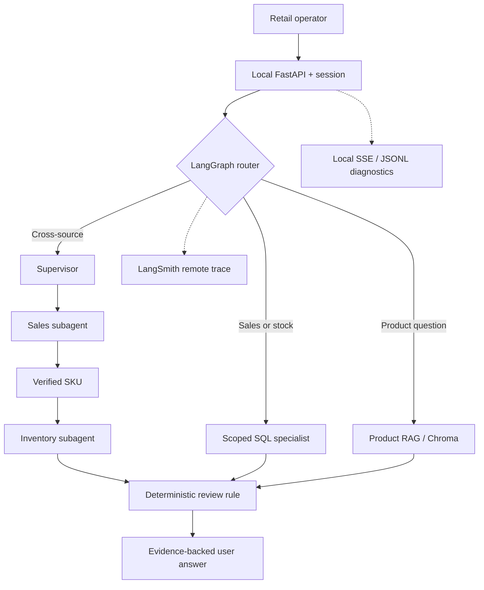

# Week 1 — FDE, harness and agent patterns

**Purpose:** explain the implemented decisions rather than simply enumerate tools. Source of truth for code is [ARCHITECTURE](../../ARCHITECTURE.md) and [DATA/API](../../DATA_API.md); evidence is [EVIDENCE](EVIDENCE.md).

## Problem-first / Forward Deployed Engineering (FDE)

Hypothesis: answering one retail business question may require humans to navigate and reconcile existing POS, OMS, WMS, ERP and product information views. Start with a **small read-only vertical slice**, verify correctness, observe interactions and revise. FDE is a delivery approach, not a separate code module. No user interview, external retailer benchmark or productivity improvement is claimed.

## Request workflow

## Harness mapping

| Layer | Ownership |
|---|---|
| **Orchestration** | LangGraph state and conditional router; scoped specialist/supervisor nodes |
| **Context** | Bounded selected-session history, product/period/location referents, safe clarification |
| **Tools** | Reviewed read-only SQL and product document retrieval; no unchecked LLM-generated SQL |
| **Verification** | Exact SKU, date/status, arithmetic, evidence/source, controlled abstention |
| **Operations** | Timeouts/retries, local logging, LangSmith tracing, evaluation and cost measurement |

The UI is the presentation boundary rather than a sixth harness core layer.

## Week 1 LangChain/agent patterns

| Pattern | Intended implementation | Boundary |
|---|---|---|
| **Chain** | Product retrieval → context → answer → citation check | A sequence of steps; do not invent a distinct RunnableSequence |
| **Agent** | Sales, Inventory and Product specialist paths | A tool wrapper is not automatically an autonomous agent |
| **Router** | Select one specialist based on task intent | Simple questions should not call every agent |
| **Subagent** | Supervisor delegates a scoped sales and inventory review | Uses grounded SKU and validated tool return |
| **Handoff** | Sales → Inventory when a supported follow-up requires it | Do not infer arbitrary “the first one” or location references without context |
| **Skill** | Load allowlisted business instructions when relevant | Skill text cannot authorize business mutations |
| **Custom workflow** | Sales → exact top SKU → Inventory → verified calculation | Human review flag only, not an order or reorder-point forecast |

A simple question can be routed once to one specialist; a compound question may need multiple calls or verification. Always show the **actual executed path** rather than labeling a diagram as proof.

## Observability, quality and cost

**Local logs/SSE** give in-app execution events; **LangSmith** is the separate remote nested execution trace. **RAGAS** evaluates a sample of grounded product answers and is not a substitute for SQL golden cases or agent routing tests.

Model cost includes each router/answer LLM call, embeddings, evaluation, retries, hosting and support. The illustrative ROI scenario assumes 1,000 questions/month, 60% helped, 4 minutes saved each, 150,000 VND/hour, 1.2M VND monthly running cost and 18M VND initial build. Gross 6M/month, net 4.8M/month, simple payback 3.75 months **if assumptions held**. These are not observed savings or provider billing. The 10% benefited sensitivity yields negative monthly net; no payback. [Original calculation and formulas](../../archive/2026-10-30/legacy/08_Agent_Cost_ROI.md).

**Main risks:** wrong routing, mis-scoped time/SKU, stale data, irrelevant RAG sources, incomplete follow-ups, synthetic bias and missing production auth. Week 2 freshness/MCP, Week 3 approval/governance and Week 4 five agents remain future scope.
